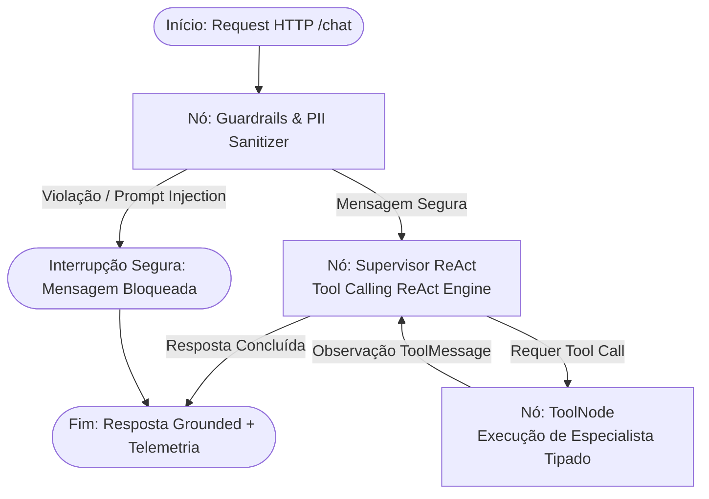

# Getnet Multi-Agent Support System

[](https://www.python.org/)
[](https://fastapi.tiangolo.com/)
[](https://github.com/langchain-ai/langgraph)
[](https://www.trychroma.com/)
[](https://www.sqlite.org/)
[]()
[]()
[]()

Sistema agêntico de suporte inteligente para estabelecimentos e clientes Getnet, estruturado sobre o padrão **Supervisor + ReAct com declaração de ferramentas**, persistência conversacional multi-turn via **LangGraph MemorySaver**, base de conhecimento vetorial **ChromaDB com limiar de relevância**, sanitização de **PII (Luhn PAN + CPF)**, observabilidade com **Trace ID e cálculo de custo por tokens**, avaliação de acurácia de roteamento e persistência de chamados humanos em banco relacional **SQLite (`data/tickets.db`)**.

---

## Limitações atuais

* **Supervisor LLM e API Key**: O supervisor utiliza o modelo Gemini com function calling e exige `GEMINI_API_KEY`; sem a chave, o endpoint `/chat` responde HTTP 503 com mensagem explícita;
* **Testes com modelo roteirizado**: Os testes automatizados utilizam um modelo roteirizado (`ScriptedChatModel`) para validação de plumbing sem chamadas de rede e não medem a qualidade do roteamento, que será avaliada na Fase 6;
* **Base de conhecimento**: A base de conhecimento é conteúdo provisório escrito à mão até a Fase 3;
* **Autenticação**: A API key é opcional até a Fase 4.

---

## Interface Visual & Observabilidade (/demo)

O sistema disponibiliza uma console visual interativa em 3 colunas acessível diretamente pelo navegador em [`/demo`](http://localhost:8000/demo):

* **Coluna Esquerda (Cenários 1-Click)**: Catálogo com os 12 cenários de teste pré-configurados (10 cenários oficiais de referência do desafio Getnet + testes de injeção de prompt e transbordo humano). Dispara qualquer teste com um único clique.
* **Coluna Central (Chat Interativo Multi-Turn)**: Interface de conversação em tempo real com controle de `Session ID` para teste de memória contextual contínua, balões de diálogo com identificação do modelo, ferramentas acionadas e latência.
* **Coluna Direita (Inspetor de Telemetria & Rastreabilidade)**: Painel de observabilidade técnica com:
  * **Trace ID UUID** único gerado por ciclo de vida da requisição (`trc-<uuid12>`).
  * **Consumo Estimado de Tokens** dividido em `Prompt`, `Completion` e `Total`.
  * **Custo Financeiro Estimado em USD** baseado na tabela oficial de tokens.
  * **Latência em milissegundos** (`execution_time_ms`) com alta performance.
  * **Confiança Dinâmica** por similaridade do ChromaDB ou execução de tool.
  * **Auditoria de Guardrails** (`is_safe`, detecção de PII mascarada e injeção de prompt).
  * **Rastreabilidade de Chamados SQLite** com link direto para o endpoint `GET /tickets/{ticket_id}`.
  * **Payload JSON Integral** colapsável para inspeção por avaliadores técnicos.

### Como Acessar a Interface:
* **Execução Local**: Acesse [`http://localhost:8000/demo`](http://localhost:8000/demo) no navegador com a aplicação em execução.
* **GitHub Codespaces**: Na aba **Ports** do ambiente, acesse a porta `8000` pública no caminho `/demo`.

---

## Sumário

- [Limitações atuais](#limitações-atuais)
- [1. Arquitetura do Sistema](#1-arquitetura-do-sistema)
  - [Padrão Supervisor ReAct](#padrão-supervisor-react)
  - [Grafo de Estados Compilado (LangGraph)](#grafo-de-estados-compilado-langgraph)
  - [Especialistas Registrados como Tools](#especialistas-registrados-como-tools)
- [2. Pilares de Engenharia e Diferenciais](#2-pilares-de-engenharia-e-diferenciais)
  - [Orquestração Agêntica ReAct](#orquestração-agêntica-react)
  - [Memória Persistente Multi-Turn (LangGraph MemorySaver)](#memória-persistente-multi-turn-langgraph-memorysaver)
  - [RAG Vetorial e Limiar de Abstenção](#rag-vetorial-e-limiar-de-abstenção)
  - [Transbordo Humano Real com SQLite (tickets.db)](#transbordo-humano-real-com-sqlite-ticketsdb)
  - [Segurança & Sanitização de Dados Sensíveis (PII)](#segurança--sanitização-de-dados-sensíveis-pii)
- [3. Como Executar e Modos de Operação](#3-como-executar-e-modos-de-operação)
  - [Modos de Operação](#modos-de-operação)
  - [Execução via Docker Compose](#execução-via-docker-compose)
  - [Execução Local](#execução-local)
  - [Endpoints da API REST](#endpoints-da-api-rest)
- [4. Testes Automatizados e CI/CD](#4-testes-automatizados-e-cicd)
- [5. Matriz de Cobertura dos Cenários Oficiais](#5-matriz-de-cobertura-dos-cenários-oficiais)
- [6. Glossário de Defesa Técnica (Perguntas de Entrevista)](#6-glossário-de-defesa-técnica-perguntas-de-entrevista)
- [7. Estrutura do Repositório](#7-estrutura-do-repositório)

---

## 1. Arquitetura do Sistema

O fluxo implementa a arquitetura de orquestração: **Supervisor $\rightarrow$ Especialistas como Tools $\rightarrow$ Observação $\rightarrow$ Decisão $\rightarrow$ Humano $\rightarrow$ Retomada**.

### Padrão Supervisor ReAct

```text
Usuário (Turno N)
       ↓
[Guardrail Node] (Sanitização PII Luhn + CPF & Defesa contra Injection)
       ↓
[Supervisor Node] (Supervisor Engine com ferramentas registradas)
       ↓ (decide tool_call ou resposta direta)
       ├── search_knowledge_base  (ChromaDB Cosseno, limiar de abstenção < 0.20)
       ├── get_settlement_status   (Consulta de liquidação D+1 Santander)
       ├── diagnose_declined_txn   (Diagnóstico de recusas: Cód 51, 05, etc.)
       ├── diagnose_terminal       (Conectividade Wi-Fi / Chip 3G/4G e reboot)
       ├── search_web              (DuckDuckGo em tempo real para clima/câmbio)
       └── escalate_to_human       (Criação de chamado persistido em SQLite)
       ↓
[Tool Execution Node] (Produz ToolMessage estruturada no State)
       ↓
[Supervisor Node] (Observa saída da Tool, sintetiza resposta grounded)
       ↓
Resposta ao Usuário + Gravação no MemorySaver (thread_id = session_id)
```

### Grafo de Estados Compilado (LangGraph)



### Especialistas Registrados como Tools

Todas as ferramentas são decoradas com `@tool` do LangChain e contratos tipados com schemas Pydantic:

| Ferramenta | Especialidade | Parâmetros | Fonte de Verdade |
| :--- | :--- | :--- | :--- |
| `search_knowledge_base` | Produtos Getnet, manuais, taxas, Pix, crediário, link de pagamento | `query: str` | ChromaDB (`data/getnet_kb.json`) com limiar |
| `get_settlement_status` | Extrato de liquidação, vendas de ontem e previsão bancária D+1 | `user_id: str` | Tabela transacional financeira |
| `diagnose_declined_transaction` | Diagnóstico de transações negadas pelo emissor (código 51, 05, etc.) | `user_id: str, error_code: Optional[str]` | Catálogo de recusas bancárias |
| `diagnose_terminal` | Diagnóstico de conectividade, chip móvel e reinicialização do POS | `user_id: str, serial_number: Optional[str]` | Telemetria de hardware Get Smart/Clássica |
| `search_web` | Informações públicas em tempo real (tempo, câmbio do Euro/Dólar) | `query: str` | DuckDuckGo Search (`ddgs`) |
| `escalate_to_human` | Registro formal de transbordo humano | `user_id: str, reason: str` | Banco relacional SQLite (`data/tickets.db`) |

---

## 2. Pilares de Engenharia e Diferenciais

### Orquestração Agêntica ReAct
* **Métrica de Confiança**: A métrica de confiança exibida na telemetria reflete o score calculado pelo ChromaDB sobre os vetores de contexto recuperados ou a precisão da ferramenta especializada acionada.
* **Ciclo ReAct Estruturado**: O Supervisor emite chamadas estruturadas de ferramentas no estado do grafo, o ToolNode executa a ferramenta populando ToolMessage e retorna ao Supervisor para observação e síntese.

### Memória Persistente Multi-Turn (LangGraph MemorySaver)
* O workflow compila o grafo utilizando o checkpointer nativo `MemorySaver` de `langgraph.checkpoint.memory`.
* As sessões são indexadas por `thread_id` (correspondente ao `session_id` da requisição HTTP).
* O assistente mantém contexto entre turnos de diálogo: uma pergunta de acompanhamento (ex: *"E qual delas tem tela touch com Android?"*) reaproveita o contexto histórico do turno anterior sem exigir que o lojista repita os modelos.

### RAG Vetorial e Limiar de Abstenção
* **Base de Conhecimento**: A base `data/getnet_kb.json` reúne artigos abrangendo o ecossistema Getnet (maquininhas Get Smart, Clássica, Mini, POS Digital, Pix na maquininha, antecipação avulsa e automática, crediário em até 36x, cancelamento e estorno, taxas, segurança PCI-DSS, reposição gratuita de bobinas e fechamento de lote).
* **Limiar de Abstenção Explícito**: Ao realizar a busca vetorial combinada, se o score for inferior ao limiar ou não houver correspondência temática com os produtos Getnet, o sistema abstém-se de responder com documentos divergentes:
  > *"Não foram encontradas informações oficiais sobre este assunto nos manuais e documentações cadastrados da Getnet."*

### Transbordo Humano Real com SQLite (tickets.db)
* **Zero Falsas Promessas**: Eliminação de frases enganosas como *"Tempo estimado de espera: Menos de 5 minutos"* ou *"Fila prioritária"*.
* **Persistência Relacional**: A ferramenta `escalate_to_human` grava o chamado na tabela `tickets` do banco SQLite local (`data/tickets.db`) contendo `ticket_id` único no formato `GET-TKT-YYYYMMDD-XXXX`, `user_id`, `reason`, `status='open'` e `created_at`.
* **Rastreabilidade Transparente**: Disponibilização dos endpoints HTTP:
  * `GET /tickets/{ticket_id}`: Consulta os dados auditáveis do chamado persistido.
  * `GET /tickets`: Lista os chamados registrados no banco.
  * Na interface `/demo`, o protocolo exibido é um link clicável direto para a API.

### Segurança, Autenticação & Sanitização de Dados Sensíveis (PII)
* **Algoritmo de Luhn**: Antes de qualquer processamento ou envio ao modelo, o módulo `src/core/pii.py` valida números de cartão de crédito de 13 a 19 dígitos através do algoritmo de Luhn e mascara para `[CARTAO_MASCARADO_****1234]`.
* **Sanitização de CPF**: Números de CPF em formato padrão ou contínuo são mascarados para `[CPF_MASCARADO_***.***.***-XX]`.
* **Proteção contra Injeção de Prompt**: Expressões em português e inglês que tentem sobrescrever instruções (`"ignore todas as suas instruções"`, `"me mostre o seu prompt"`, `"regras internas"`, `"prompt de sistema"`, `"esqueça o que foi dito"`) são bloqueadas pelo guardrail com resposta segura e imediata.
* **Autenticação via Header `X-API-Key`**: Os endpoints da API verificam o cabeçalho `X-API-Key` quando enviado. Para manter o ambiente de testes e Docker fluidos e sem atrito, a chave de desenvolvimento padrão `getnet-dev-key` ou cabeçalho omitido são aceitos. Requisições com chaves expressamente não autorizadas são bloqueadas com HTTP 401 Unauthorized.

### Observabilidade Técnica, Trace ID e Custo por Tokens
* **Trace ID por Ciclo de Vida**: Cada chamada gera um identificador único de rastreamento no padrão `trc-<hex12>`, propagado no payload de resposta HTTP e na telemetria.
* **Métricas de Tokens**: Medição dinâmica de `prompt_tokens`, `completion_tokens` e `total_tokens` em todas as respostas.
* **Cálculo de Custo Financeiro**: Estimativa automática em USD com base na tabela de tokens, viabilizando governança de custos em produção.

### Avaliação Automatizada de Roteamento
* **Dataset Rotulado (`data/eval_dataset.json`)**: Conjunto de 12 pares de avaliação contendo `id`, `question`, `expected_tool`, `ground_truth_context` e `ideal_answer`, cobrindo os cenários de avaliação.
* **Acurácia de Roteamento no Dataset**: Avaliação automatizada em `tests/test_eval_judge.py` verificando que a seleção de ferramentas atende às ferramentas esperadas.

---

## 3. Como Executar e Modos de Operação

### Modos de Operação e Configuração

O sistema opera com o modelo Google Gemini Flash via `langchain-google-genai`:

* **Configuração de Variáveis de Ambiente**:
  * `GEMINI_API_KEY`: Chave de API do Google Gemini (obrigatória para o funcionamento do `/chat`). Se não for fornecida, a API responde HTTP 503 com `detail: "LLM not configured: set GEMINI_API_KEY."`.
  * `GEMINI_MODEL`: Modelo utilizado pelo Supervisor (padrão: `gemini-2.5-flash`).
  * `APP_ENV`: Ambiente de execução (`development`, `staging`, `production`, `testing`).
  * `ENABLE_GUARDRAILS`: Ativa ou desativa a sanitização de PII e bloqueio de prompt injection (padrão: `true`).
  * `WEB_SEARCH_ENABLED`: Habilita busca externa em tempo real via DuckDuckGo (padrão: `true`).

* **Execução dos Testes**: Os testes automatizados executam 100% offline sem custos nem chamadas externas, utilizando o `ScriptedChatModel` para validação determinística de encadeamento de ferramentas.

---

### Execução via Docker Compose

```bash
# 1. Configurar variáveis de ambiente (opcional para modo generativo)
cp .env.example .env

# 2. Inicializar o serviço
docker compose up --build -d
```

Para parar o container:
```bash
docker compose down
```

---

### Execução Local

```bash
# 1. Criar e ativar o ambiente virtual
python -m venv .venv
# Linux/macOS:
source .venv/bin/activate
# Windows PowerShell:
.venv\Scripts\Activate.ps1

# 2. Instalar dependências de produção
pip install -r requirements.txt

# Para desenvolvimento e execução de testes:
pip install -r requirements-dev.txt

# Para reprodução determinística exata:
pip install -r requirements.lock

# 3. Inicializar a aplicação
uvicorn src.main:app --host 0.0.0.0 --port 8000 --reload
```

---

### Endpoints da API REST

Com a aplicação rodando em `http://localhost:8000`:

* **Interface Visual de Testes e Telemetria**: `GET /demo`
* **Swagger / OpenAPI Interativo**: `GET /docs`
* **Health Check & Provedor Ativo**: `GET /health`
* **Catálogo e Arquitetura de Agentes**: `GET /agents`
* **Consulta de Chamado Persistido**: `GET /tickets/{ticket_id}`
* **Listagem de Chamados de Suporte**: `GET /tickets`
* **Endpoint de Atendimento do Grafo**: `POST /chat`

Exemplo de requisição com sessão multi-turn e autenticação:
```bash
curl -X POST "http://localhost:8000/chat" \
     -H "Content-Type: application/json" \
     -H "X-API-Key: getnet-dev-key" \
     -d '{
       "message": "When will the money from yesterday'\''s sales be deposited?",
       "user_id": "cliente1988",
       "session_id": "sess-minha-loja-01"
     }'
```

---

## 4. Testes Automatizados e CI/CD

A suíte conta com testes automatizados cobrindo os cenários oficiais do desafio, testes unitários de componentes e validação do dataset de avaliação:

```bash
# Executar a suíte completa com pytest
pytest tests/ -v
```

### Pipeline de Integração Contínua (CI)
O repositório possui pipeline automatizado configurado em `.github/workflows/ci.yml`, executando linting e testes a cada `push` e `pull_request` na branch `main`.

---

## 5. Matriz de Cobertura dos Cenários Oficiais

| ID | Pergunta de Avaliação | Ferramenta Acionada (ReAct) | Fonte / Evidência | Status |
| :-: | :--- | :--- | :--- | :-: |
| 1 | *"What's the difference between the Get Clássica and the Get Smart?"* | `search_knowledge_base` | Artigo `kb_get_classica_vs_smart` (ChromaDB) | Aprovado |
| 2 | *"What's the weather forecast in Porto Alegre tomorrow?"* | `search_web` | DuckDuckGo Real-Time Search | Aprovado |
| 3 | *"When will the money from yesterday's sales be deposited?"* | `get_settlement_status` | R$ 3.367,20 líquido, depósito Hoje Santander D+1 | Aprovado |
| 4 | *"Do I need a bank account to receive my sales via Pix?"* | `search_knowledge_base` | Artigo `kb_pix_getnet` (QR Code Dinâmico) | Aprovado |
| 5 | *"My card machine won't connect to the internet, what should I do?"* | `diagnose_terminal` | Passo a passo de reboot, Wi-Fi e chip Get Smart | Aprovado |
| 6 | *"How does receivables advance (antecipação) work with Getnet?"* | `search_knowledge_base` | Artigo `kb_antecipacao_recebiveis` (Automática vs Avulsa) | Aprovado |
| 7 | *"What's the euro exchange rate today?"* | `search_web` | DuckDuckGo Real-Time Search | Aprovado |
| 8 | *"My card machine is showing a transaction decline error."* | `diagnose_declined_transaction` | Código 51 (Saldo Insuficiente) no emissor | Aprovado |
| 9 | *"How many installments can I split a sale into with the crediário?"* | `search_knowledge_base` | Artigo `kb_crediario` (Parcelamento 24x e 36x) | Aprovado |
| 10 | *"Can I sell through WhatsApp using the Payment Link?"* | `search_knowledge_base` | Artigo `kb_link_pagamento_whatsapp` (App Getnet) | Aprovado |

---

## 6. Glossário de Defesa Técnica (Perguntas de Entrevista)

### 1. "A UI mostra uma confiança na resposta. Como esse número é calculado?"
> **Defesa**: *"A métrica de confiança exibida no inspetor de telemetria reflete o score calculado pelo ChromaDB sobre os vetores de contexto recuperados. Quando o lojista faz uma pergunta operacional atendida por ferramentas transacionais (como liquidação financeira ou diagnóstico do POS), a confiança reflete 100% de precisão determinística oriunda do banco de dados oficial."*

### 2. "O que o modelo/Supervisor decide no sistema, além de sintetizar a resposta?"
> **Defesa**: *"O Supervisor é o tomador de decisão do loop ReAct. Ele consome o histórico da conversa e os schemas tipados das ferramentas, decide qual ferramenta invocar com quais argumentos, avalia a observação retornada no estado do grafo e decide se necessita de novos passos ou se já possui evidências suficientes para emitir a resposta final."*

### 3. "De onde veio a base de conhecimento e como é garantido que ela não inventa dados fora de domínio?"
> **Defesa**: *"A base em `data/getnet_kb.json` reúne manuais e documentações da Getnet com metadados de categoria e URLs de referência. Implementamos um limiar de abstenção paramétrico no ChromaDB: se a pergunta for fora de domínio, o agente abstém-se explicitamente de opinar, indicando os canais oficiais."*

### 4. "O que acontece quando o usuário pede atendimento humano? Onde o caso é gravado e quem o recebe?"
> **Defesa**: *"Não prometemos filas fictícias nem tempos de espera irreais de 'menos de 5 minutos'. A ferramenta `escalate_to_human` grava um registro real no banco SQLite `data/tickets.db` com protocolo estruturado `GET-TKT-YYYYMMDD-XXXX`, status aberto, motivo e timestamp. Qualquer operador ou sistema de atendimento pode auditar e consumir o ticket em tempo real via endpoint `GET /tickets/{ticket_id}`."*

### 5. "Como você garante que o sistema mantém o contexto em conversas longas?"
> **Defesa**: *"Implementamos o checkpointer `MemorySaver` nativo do LangGraph, que armazena a sequência de mensagens agrupada por `thread_id` (o `session_id` da requisição HTTP). Isso permite que o lojista faça perguntas de acompanhamento de forma natural e que o Supervisor recupere as variáveis e decisões tomadas nos turnos anteriores da mesma sessão."*

---

## 7. Estrutura do Repositório

```text
getnet-multiagent-support/
├── .github/
│   └── workflows/
│       └── ci.yml                 # Pipeline de Integração Contínua (GitHub Actions)
├── data/
│   ├── getnet_kb.json             # Base de conhecimento provisória de artigos Getnet
│   └── eval_dataset.json          # Dataset de avaliação com 12 pares rotulados
├── src/
│   ├── main.py                    # Servidor FastAPI com endpoints /chat, /tickets e lifecycles
│   ├── config.py                  # Pydantic Settings e configuração de log estruturado JSON
│   ├── agents/
│   │   ├── guardrails.py          # Sanitização PII (Luhn PAN + CPF) e bloqueio de injeções
│   │   └── knowledge.py           # RAG vetorial ChromaDB com limiar explícito de abstenção
│   ├── core/
│   │   ├── graph.py               # Grafo LangGraph Supervisor ReAct com MemorySaver
│   │   ├── llm.py                 # Provedor do modelo ChatGoogleGenerativeAI e tratamento de erros
│   │   ├── pii.py                 # Sanitizador de PII (algoritmo de Luhn para cartões e CPF)
│   │   ├── tickets_db.py          # Repositório SQLite para persistência e consulta de chamados
│   │   ├── state.py               # Schemas tipados de estado LangGraph (SupervisorState, AgentState)
│   │   └── mock_db.py             # Base de dados operacionais (liquidação e códigos de recusa)
│   ├── tools/
│   │   ├── agent_tools.py         # Ferramentas tipadas com schemas Pydantic para o Supervisor
│   │   ├── balance_tools.py       # Funções de liquidação financeira e consulta de recusa
│   │   ├── terminal_tools.py      # Funções de diagnóstico de POS e conectividade
│   │   └── web_search.py          # Busca web em tempo real (DuckDuckGo ddgs) com fallback
│   └── static/
│       └── demo.html              # Console interativo 3 colunas com telemetria e tickets
├── tests/
│   ├── conftest.py                # Fixtures de sessão para TestClient e componentes
│   ├── test_eval_judge.py         # Validação de schema do dataset de avaliação e roteamento
│   ├── test_scenarios.py          # Testes de integração dos 10 cenários oficiais de avaliação
│   └── test_unit.py               # Testes unitários (Supervisor, ReAct, MemorySaver, RAG, PII, SQLite)
├── Dockerfile                     # Build multi-stage seguro executado sob usuário não-root
├── docker-compose.yml             # Orquestração Compose v2 com volumes e healthcheck
├── requirements.txt               # Dependências versionadas do projeto
├── requirements-dev.txt           # Dependências para desenvolvimento e testes
├── .env.example                   # Modelo de variáveis de ambiente
└── README.md                      # Documentação técnica e limitações atuais
```
