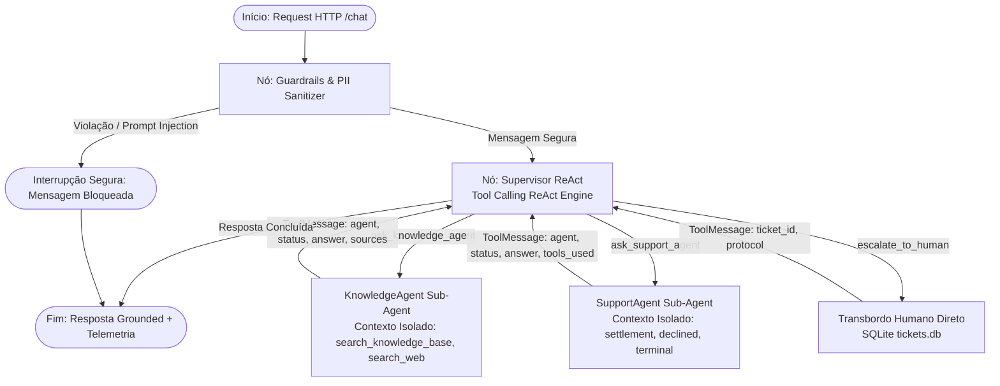

# Getnet Multi-Agent Support System

[](https://www.python.org/)
[](https://fastapi.tiangolo.com/)
[](https://github.com/langchain-ai/langgraph)
[](https://www.sqlite.org/)
[]()
[]()
[]()

Sistema agêntico de suporte inteligente para estabelecimentos e clientes Getnet, estruturado sobre o padrão **Supervisor + ReAct com declaração de ferramentas**, persistência conversacional multi-turn em banco SQLite via **LangGraph SqliteSaver**, base de conhecimento vetorial **índice de embeddings com limiar de relevância**, sanitização de **PII (Luhn PAN + CPF)**, observabilidade com **Trace ID e contagem de tokens**, e persistência e ciclo de vida de chamados humanos em banco relacional **SQLite (`data/tickets.db`)**.

---

## Limitações atuais

* **Supervisor LLM e API Key**: O supervisor utiliza o modelo Gemini com function calling e exige `GEMINI_API_KEY`; sem a chave, o endpoint `/chat` responde HTTP 503 com mensagem explícita;
* **Testes com modelo roteirizado**: Os testes automatizados utilizam um modelo roteirizado (`ScriptedChatModel`) para validação de plumbing sem chamadas de rede e não medem a qualidade do roteamento; a qualidade com o modelo real é medida pela avaliação (`reports/eval_models.md`, três execuções por modelo);
* **Base de conhecimento**: Base oficial ingerida e vetorizada (`gemini-embedding-2`), com avaliação de retrieval e limiar calibrado na Fase 3D;
* **Persistência e Isolamento de Memória**: O histórico de sessões é persistido em SQLite via `SqliteSaver` no arquivo `CHECKPOINT_DB_PATH` (padrão `data/checkpoints.db`; no Docker, `/app/state/checkpoints.db` no volume `getnet_app_state`), sobrevivendo a reinícios e isolado por `user_id:session_id`. Limitações honestas: não há expiração/limpeza automática de conversas antigas; cada réplica utiliza seu próprio arquivo SQLite (sem memória compartilhada entre instâncias sem banco compartilhado); o rate limit é controlado em memória por processo; o app não sobe com `API_KEYS` inválido ou banco inacessível (e responde 503 se a configuração ficar inválida em execução).

---

## Autoria e revisão

Este repositório foi construído pelo candidato com duas ferramentas de IA, em papéis separados:

* **Implementação:** o código, os testes, este README e o `docs/STATUS.md` foram escritos pelo Google Antigravity (modelo Gemini 3.8 Flash), uma fase por vez, seguindo os prompts de fase em `docs/phase-prompts/`. Alguns trechos do README, como a tabela "Afirmações e evidências", vieram prontos nesses prompts.
* **Planejamento e revisão:** o plano (`docs/SPEC.md`), os prompts de fase (`docs/phase-prompts/`), os verificadores (`scripts/verify_*.py`), os casos rotulados da avaliação (`data/eval/cases.jsonl`) e os prompts dos agentes e do juiz (`src/prompts/`) foram escritos ou revisados pelo Claude (Anthropic), em sessões separadas das do Antigravity. Como revisor, o Claude conferiu cada fase lendo o diff e rodando os verificadores numa cópia própria do repositório.
* **Decisões:** o candidato definiu o escopo e os padrões (por exemplo, o modelo padrão), aprovou cada fase e rodou as avaliações com modelo real no próprio terminal. Os commits saem da conta do candidato, feitos pelo Antigravity ao fim de cada fase; por isso todos têm o mesmo autor.

Isto não é uma revisão independente: o mesmo candidato conduz as duas ferramentas, e o Claude escreveu tanto os critérios de aceite quanto os rótulos da avaliação. O que os verificadores oferecem é reprodutibilidade: rodam sem chave de API (por exemplo, `python scripts/verify_phase9a.py`) e qualquer pessoa pode conferir o resultado.

---

## Interface Visual & Observabilidade (/demo)

O sistema disponibiliza uma console visual interativa em 3 colunas acessível diretamente pelo navegador em [`/demo`](http://localhost:8000/demo):

* **Coluna Esquerda (Cenários 1-Click)**: Catálogo com os cenários de teste pré-configurados (os 10 oficiais do desafio e testes de injeção e transbordo). Dispara qualquer teste com um único clique.
* **Coluna Central (Chat Interativo Multi-Turn)**: Interface de conversação em tempo real com controle de `Session ID` para teste de memória contextual contínua, balões de diálogo com identificação do modelo, ferramentas acionadas e latência.
* **Coluna Direita (Inspetor de Telemetria & Rastreabilidade)**: Painel de observabilidade técnica com:
  * **Trace ID** único gerado por ciclo de vida da requisição (`trc-<hex12>`).
  * **Consumo Estimado de Tokens** dividido em `input_tokens`, `output_tokens` e `total_tokens`.
  * **Custo estimado em USD**: calculado por turno no plano pago Standard a partir da tabela oficial de preços (`estimated_cost_usd`).
  * **Latência em milissegundos** (`execution_time_ms`).
  * **Auditoria de Guardrails** (`is_safe`, detecção de PII mascarada e injeção de prompt).
  * **Rastreabilidade de Chamados SQLite** com link direto para o endpoint `GET /tickets/{ticket_id}`.
  * **Payload JSON Integral** colapsável para inspeção por avaliadores técnicos.

### Como Acessar a Interface:
* **Execução Local**: Acesse [`http://localhost:8000/demo`](http://localhost:8000/demo) no navegador com a aplicação em execução.
* **GitHub Codespaces**: Na aba **Ports** do ambiente, acesse a porta `8000` pública no caminho `/demo`.

---

## Sumário

- [Limitações atuais](#limitações-atuais)
- [Autoria e revisão](#autoria-e-revisão)
- [1. Arquitetura do Sistema](#1-arquitetura-do-sistema)
  - [Padrão Supervisor ReAct](#padrão-supervisor-react)
  - [Grafo de Estados Compilado (LangGraph)](#grafo-de-estados-compilado-langgraph)
  - [Especialistas Registrados como Tools](#especialistas-registrados-como-tools)
- [2. Pilares de Engenharia e Diferenciais](#2-pilares-de-engenharia-e-diferenciais)
  - [Orquestração Agêntica ReAct](#orquestração-agêntica-react)
  - [Memória Persistente Multi-Turn (LangGraph SqliteSaver)](#memória-persistente-multi-turn-langgraph-sqlitesaver)
  - [RAG Vetorial e Limiar de Abstenção](#rag-vetorial-e-limiar-de-abstenção)
  - [Transbordo Humano Real com SQLite (tickets.db)](#transbordo-humano-real-com-sqlite-ticketsdb)
  - [Segurança & Sanitização de Dados Sensíveis (PII)](#segurança--sanitização-de-dados-sensíveis-pii)
- [3. Como Executar e Modos de Operação](#3-como-executar-e-modos-de-operação)
  - [Modos de Operação](#modos-de-operação)
  - [Execução via Docker Compose](#execução-via-docker-compose)
  - [Execução Local](#execução-local)
  - [Endpoints da API REST](#endpoints-da-api-rest)
- [4. Avaliação e Métricas](#4-avaliação-e-métricas)
  - [Dataset de Avaliação (data/eval/cases.jsonl)](#dataset-de-avaliação-dataevalcasesjsonl)
  - [Checagens Determinísticas](#checagens-determinísticas)
  - [Subconjunto Offline no CI](#subconjunto-offline-no-ci-python--m-srceval-offline)
  - [Resultados da avaliação: comparação de modelos](#resultados-da-avaliação-comparação-de-modelos-3-execuções-por-modelo-2026-11-08)
  - [Resultados da avaliação (full-1, histórica)](#resultados-da-avaliação-execução-full-1-2026-11-07)
- [5. Testes Automatizados e CI/CD](#5-testes-automatizados-e-cicd)
- [6. Matriz de Cobertura dos Cenários Oficiais](#6-matriz-de-cobertura-dos-cenários-oficiais)
- [7. Glossário de Defesa Técnica (Perguntas de Entrevista)](#7-glossário-de-defesa-técnica-perguntas-de-entrevista)
- [8. Estrutura do Repositório](#8-estrutura-do-repositório)
- [9. Afirmações e evidências](#9-afirmações-e-evidências)

---

## 1. Arquitetura do Sistema

O fluxo implementa a arquitetura de orquestração com subagentes especialistas: **Supervisor $\rightarrow$ Especialistas (KnowledgeAgent / SupportAgent) ou Transbordo Humano $\rightarrow$ Observação $\rightarrow$ Decisão $\rightarrow$ Resposta Grounded**.

### Padrão Supervisor ReAct com Subagentes Especialistas

O `SupervisorAgent` não invoca ferramentas operacionais de baixo nível diretamente. Ele analisa o diálogo e delega para subagentes especialistas isolados (`KnowledgeAgent` e `SupportAgent`) ou efetua o transbordo humano direto (`escalate_to_human`):

```text
Usuário (Turno N)
       ↓
[Guardrail Node] (Sanitização PII Luhn + CPF & Defesa contra Injection)
       ↓
[Supervisor Node] (Supervisor ReAct com ferramentas de delegação)
       ├── ask_knowledge_agent  → [KnowledgeAgent] (search_knowledge_base, search_web)
       ├── ask_support_agent    → [SupportAgent]   (get_settlement_status, diagnose_declined_transaction, diagnose_terminal)
       └── escalate_to_human    → Registro formal de transbordo no SQLite (tickets.db)
       ↓
[Tool Execution Node] (Executa especialista em contexto isolado ou chamado humano)
       ↓
[Supervisor Node] (Observa saída ToolMessage estruturada e sintetiza resposta grounded)
       ↓
Resposta ao Usuário + Gravação no SqliteSaver (thread_id = user_id:session_id)
```

### Grafo de Estados Compilado (LangGraph)



### Isolamento de Contexto e Limite de Passos dos Especialistas

* **Isolamento de Contexto**: Cada especialista (`KnowledgeAgent`, `SupportAgent`) é instanciado como `SpecialistAgent` e executa em um loop isolado com `[SystemMessage(prompt), HumanMessage(task)]`, sem acesso ao histórico completo da conversa do usuário, prevenindo vazamentos de contexto e alucinações cruzadas.
* **Injeção de Identidade Segura**: O `user_id` autenticado é injetado programaticamente via `RunnableConfig` (`config={"configurable": {"user_id": user_id}}`) e nunca exposto aos parâmetros visíveis ao LLM.
* **Limite de Passos dos Especialistas**: Cada especialista executa no máximo `MAX_SPECIALIST_STEPS` (padrão: 4) chamadas ao modelo. Se o limite for atingido, o especialista devolve status `"step_limit"` e o Supervisor trata o retorno graciosamente. O supervisor por sua vez possui o limite global `MAX_SUPERVISOR_STEPS` (padrão: 6).
* **Ferramentas do Supervisor e dos Especialistas**:
  * `ask_knowledge_agent`: delega dúvidas conceituais, produtos Getnet e dados públicos em tempo real ao `KnowledgeAgent`.
  * `ask_support_agent`: delega consultas sobre a conta do lojista (extrato D+1, transações negadas, conectividade de terminal) ao `SupportAgent`.
  * `escalate_to_human`: transbordo direto para especialista humano em casos de reclamações formais ou solicitação explícita.

### Especialistas Registrados como Tools do Supervisor e dos Especialistas

Todas as ferramentas são decoradas com `@tool` do LangChain e contratos tipados com schemas Pydantic:

| Ferramenta | Pertence a | Descrição |
| :--- | :--- | :--- |
| `ask_knowledge_agent` | Supervisor | Delega perguntas sobre produtos Getnet ou dados públicos em tempo real ao KnowledgeAgent |
| `ask_support_agent` | Supervisor | Delega solicitações de conta de lojista ao Customer Support Agent |
| `escalate_to_human` | Supervisor | Cria chamado humano persistido em `tickets.db` |
| `search_knowledge_base` | KnowledgeAgent | Busca vetorial semântica no índice oficial (gemini-embedding-2) com limiar |
| `search_web` | KnowledgeAgent | Busca pública em tempo real (DuckDuckGo) |
| `get_settlement_status` | SupportAgent | Consulta extrato e valores com mascaramento bancário de conta de destino |
| `diagnose_declined_transaction` | SupportAgent | Diagnóstico de transações negadas pelo emissor |
| `diagnose_terminal` | SupportAgent | Diagnóstico de conectividade e hardware de maquininhas Get Smart/Clássica |

As ferramentas de conta leem uma base simulada (`src/core/mock_db.py`) com um único lojista, `cliente1988`, ao qual a chave de desenvolvimento `getnet-dev-key` está vinculada. Para qualquer outro `user_id`, elas devolvem `{"status": "not_found", "error": "merchant_not_found"}` e nenhum valor: o mock não inventa conta, terminal nem transação (`tests/test_mock_not_found.py`). O Customer Support Agent então informa que a conta não foi encontrada e sugere o atendimento humano.

---

## 2. Pilares de Engenharia e Diferenciais

### Orquestração Agêntica ReAct
* **Ciclo ReAct Estruturado**: O Supervisor emite chamadas estruturadas de ferramentas no estado do grafo, o ToolNode executa a ferramenta populando ToolMessage e retorna ao Supervisor para observação e síntese.

### Memória Persistente Multi-Turn (LangGraph SqliteSaver)
* O workflow compila o grafo utilizando o checkpointer relacional `SqliteSaver` de `langgraph.checkpoint.sqlite`, persistido no caminho definido por `CHECKPOINT_DB_PATH` (padrão: `data/checkpoints.db`).
* As sessões são indexadas por `thread_id` composto no formato `f"{user_id}:{session_id}"`, assegurando isolamento estrito entre usuários distintos mesmo que compartilhem o mesmo `session_id`.
* O estado conversacional persiste em disco e sobrevive a reinicializações completas do serviço. O assistente mantém contexto entre turnos de diálogo: perguntas de acompanhamento reaproveitam o contexto histórico do turno anterior sem exigir que o lojista repita os dados já informados.

### RAG Vetorial e Pipeline de Conhecimento (Fase 3C)
* **Knowledge Agent Conectado ao Índice Real**:
  O `KnowledgeAgent` agora realiza consultas semânticas reais diretamente sobre o índice vetorial em `data/index`, gerado pelo modelo `gemini-embedding-2` (768 dimensões). Cada fato respondido referencia a URL da fonte oficial e a data de coleta (`fetched_at`). Quando não há trechos suficientes que superem o limiar de relevância, o retriever abstém-se formalmente (`status: "abstain"`), prevenindo respostas especulativas.
* **Por que trocamos a base**:
  A base antiga era um arquivo JSON escrito à mão (`getnet_kb.json`) que continha informações desatualizadas ou imprecisas. Um exemplo verificável: a base antiga afirmava que o parcelamento no crediário era em até 36x, enquanto a documentação oficial na página https://site.getnet.com.br/crediario/ estabelece parcelamento em até 48x (com a ressalva de que as condições variam conforme o emissor do cartão). Com a ingestão automatizada e o novo índice vetorial, o assistente passa a responder estritamente embasado nos documentos oficiais coletados.
* **Pipeline Oficial de RAG**:
  1. **Ingestão (`src/rag/ingest.py`)**: Coleta ética de fontes oficiais (`data/sources.yaml`), respeitando `robots.txt` e gerando o corpus em `data/corpus/pages.jsonl`.
  2. **Fragmentação (`src/rag/chunking.py`)**: Filtra linhas de boilerplate (repetidas em $\ge 4$ páginas), linhas sem caracteres alfanuméricos, descarta páginas com menos de 120 caracteres de conteúdo retido e agrupa as linhas restantes na ordem original (verbatim) em chunks de até 900 caracteres, anexando caudas curtas (< 120 chars) ao trecho anterior.
  3. **Geração de Embeddings (`src/core/llm.py`)**: Utiliza o modelo `gemini-embedding-2` com 768 dimensões, configurando `RETRIEVAL_DOCUMENT` para indexação de chunks e `RETRIEVAL_QUERY` para consultas em tempo de execução.
  4. **Índice Vetorial Commitado (`src/rag/index.py`)**: Vetores com normalização L2 persistidos em `data/index/embeddings.npy` (float32), metadados em `data/index/index_meta.json` e chunks em `data/index/chunks.jsonl`.
  5. **Retriever e Abstenção (`src/rag/retriever.py`)**: Busca por similaridade de cosseno com limiar de corte calibrado (`RAG_MIN_SCORE = 0.61`). Quando a melhor similaridade de cosseno fica abaixo desse limiar, o retriever devolve status `abstain`.

#### Avaliação do retrieval e Calibração de Limiar (Fase 3D)
O sistema avalia a qualidade do retrieval e a política de abstenção sobre um conjunto rotulado de 48 consultas (`data/eval/retrieval_labeled.jsonl`: 30 respondíveis [21 PT, 9 EN], 10 *uncovered* e 8 *off-topic*). Os detalhes completos e curvas estão disponíveis em [`reports/retrieval_calibration.md`](reports/retrieval_calibration.md) (e JSON em [`reports/retrieval_calibration.json`](reports/retrieval_calibration.json)).

* **Métricas de Retrieval (Consultas Respondíveis)**:
  | Métrica | Geral (n=30) | Português (n=21) | Inglês (n=9) |
  | :--- | :---: | :---: | :---: |
  | **hit@1** | 0.900 | 0.952 | 0.778 |
  | **hit@3** | 0.967 | 1.000 | 0.889 |
  | **hit@5** | 0.967 | 1.000 | 0.889 |
  | **mrr@10** | 0.933 | 0.976 | 0.833 |
  | **answer_hit@3** | 0.900 | 0.952 | 0.778 |

* **Limiar Escolhido (`RAG_MIN_SCORE = 0.61`) e Métricas de Abstenção**:
  * No conjunto de calibração do retrieval (48 consultas; as 8 fora do domínio são fáceis, como receitas e futebol), o limiar 0.61 deixa passar as 30 respondíveis e barra as 8 fora do domínio, com margem de apenas 0.04. Isso mede só o retriever: na avaliação ponta a ponta (`full-1`), dois pedidos fora do tema não foram recusados (`o02`, `o04`).
  * **Abstenção Uncovered**: 0.000 (perguntas *uncovered* estão próximas do vocabulário do domínio Getnet por construção e não são filtradas apenas pelo limiar de similaridade vetorial, dependendo do Knowledge Agent para reconhecer a ausência de resposta no trecho e responder "não encontrado nas fontes oficiais").
  * **Avisos do Relatório**: `[!WARNING]` `uncovered_not_filtered` (comportamento esperado e documentado na especificação).

### Fontes de Dados e Corpus Oficial (Fase 3A)
* **Política de Fontes Oficiais**:
  * **getnet.net/en**: Conteúdo global institucional, soluções presenciais, e-commerce, omnichannel e APIs.
  * **site.getnet.com.br**: Conteúdo de produtos e serviços Getnet para o mercado brasileiro (maquininhas, Pix, taxas, antecipação e manuais). O domínio `www.santander.com.br` foi removido porque sua CDN (Akamai) bloqueia o User-Agent do projeto com HTTP 403 no `robots.txt`; já o `site.getnet.com.br` não possui `robots.txt` (retorna HTTP 404), o que pela RFC 9309 indica ausência de restrições de rastreamento.
  * **getnet.com.br**: Portal institucional brasileiro condicionado ao cumprimento estrito das regras do `robots.txt`.
  * **getnet.net/pt**: Expressamente excluído do escopo por pertencer ao mercado de Portugal.
* **Armazenamento do Corpus**: Os documentos e auditoria de coleta ficam persistidos no diretório `data/corpus` (`pages.jsonl` e `manifest.json`).
* **Como Regenerar o Corpus**: A coleta pode ser executada respeitando taxa limite e `robots.txt` com:
  ```bash
  python -m src.rag.ingest
  ```

### Transbordo Humano Real com SQLite e Ciclo de Vida de Tickets (Fase 5A)
* **Sem prazos nem filas**: o prompt do supervisor proíbe prometer prazo, posição na fila ou expressões como "em breve"; é uma instrução ao modelo, não uma garantia (a avaliação mede o comportamento).
* **Estrutura e Dados Persistidos**: A ferramenta `escalate_to_human` grava o chamado no banco SQLite configurado em `TICKETS_DB_PATH` (padrão: `data/tickets.db`; no Docker, `/app/state/tickets.db` no volume `getnet_app_state`). Cada registro armazena:
  * `ticket_id`: Identificador único no formato `GET-TKT-YYYYMMDD-<10 hexadecimais>`.
  * `user_id`: Identificador do lojista autenticado.
  * `session_id`: Identificador da sessão em que o transbordo foi acionado.
  * `reason`: Motivo detalhado do encaminhamento ao operador.
  * `priority`: Nível de prioridade (`standard` ou `high` para órgãos regulatórios como Procon ou ouvidoria).
  * `transcript`: Snapshot estruturado das últimas 20 mensagens da conversa contendo papéis `user` e `assistant` com dados sensíveis previamente sanitizados pelo guardrail (números de cartão e CPF mascarados).
  * `status`: Estado atual no ciclo de vida do chamado.
  * `operator_reply`, `operator_id`, `answered_at`: Resposta registrada pelo operador humano.
* **Ciclo de Vida de Status**:
  * Transições permitidas:
    * `open` $\rightarrow$ `in_progress`, `answered`, `closed`
    * `in_progress` $\rightarrow$ `answered`, `closed`
    * `answered` $\rightarrow$ `closed`
    * `closed` (estado terminal; não aceita reabertura nem novas respostas)
* **Atualização por Operadores (`PATCH /tickets/{ticket_id}`)**:
  * Exclusivo para credenciais com papel `operator` (requisições de clientes recebem HTTP 403 Forbidden).
  * Permite atualizar o status ou registrar uma resposta (`reply`), o que transiciona o ticket para `answered` e registra o horário de resposta (`answered_at`) e o `operator_id`.
  * Exemplo com `curl`:
    ```bash
    curl -X PATCH http://localhost:8000/tickets/GET-TKT-20261107-ABCD \
      -H "X-API-Key: sua-chave-de-operador" \
      -H "Content-Type: application/json" \
      -d '{"reply": "Sua solicitação de alteração cadastral foi processada com sucesso."}'
    ```
* **Consulta pelo Cliente (`GET /tickets/{ticket_id}`)**:
  * O lojista dono do chamado pode consultar o protocolo a qualquer momento e visualizar o `status`, o histórico enviado e a `operator_reply` fornecida pelo operador.

### Portão de Transbordo Humano e Entrega de Resposta no Chat (Fase 5B)
* **Controle de Estado com `pending_ticket_id`**: Ao registrar um chamado com sucesso, o grafo grava o identificador do ticket no campo persistido `pending_ticket_id` do estado conversacional, mantido pelo `SqliteSaver` entre turnos e reinicializações.
* **Nó `handoff_gate` após o Guardrail**: O fluxo de atendimento posiciona o nó `handoff_gate` imediatamente após o `guardrail`. Isso garante que todas as mensagens enviadas pelo cliente enquanto o chamado aguarda resposta tenham seus dados sensíveis (PII) mascarados e fiquem salvas no histórico de mensagens.
* **Mensagem Fixa Sem Chamada ao LLM**: Enquanto o chamado estiver em aberto ou em atendimento (`open` ou `in_progress`), o `handoff_gate` responde com uma mensagem de espera padronizada e bilíngue informando o número do protocolo, sem invocar o LLM (`llm_model: None`, `tokens: None`) e sem fazer qualquer promessa enganosa de tempo ou fila.
* **Entrega Única da Resposta do Operador (`delivered_at`)**: Quando o operador responde ao chamado via `PATCH /tickets/{id}`, o próximo turno do cliente entrega a resposta humana com o prefixo oficial, grava a data de entrega no banco (`delivered_at`), limpa o `pending_ticket_id` e marca o evento com `handoff: {"status": "delivered"}`. Turnos seguintes retornam automaticamente ao atendimento convencional pelo supervisor.
* **Retomada de Atendimento (`resumed`)**: Se o chamado for fechado pelo operador sem resposta (`status: "closed"`), o portão limpa a pendência, define `handoff: {"status": "resumed"}` e direciona a mensagem no mesmo turno para o supervisor do bot.
* **Metadados da API (`metadata.handoff`)**: Nos turnos em que o portão intercepta a conversa (`pending` ou `delivered`), a resposta expõe `agent_type = "HumanHandoff"` e o objeto `handoff` com o `ticket_id` e seu respectivo status.
* **Por que não usamos `interrupt()` do LangGraph**: Optamos por não usar `interrupt()` porque a retomada do atendimento depende de uma ação assíncrona de terceiros (o operador) e o lojista pode continuar enviando mensagens durante a espera; com o portão `handoff_gate`, as mensagens intermediárias do cliente passam pelo guardrail e são preservadas na memória conversacional sem bloquear a execução do grafo.

### Escalonamento Automático por Abstenção Repetida e Atualização do Chamado (Fase 5C)
* **Critério de Abstenção**: Uma consulta ao `KnowledgeAgent` é classificada como abstenção quando o especialista não retorna nenhuma fonte (`sources` vazio, tanto de documentos oficiais quanto de busca web).
* **Limitação Importante**: A abstenção é estritamente contabilizada pela ausência de fontes no resultado do retriever/especialista; uma resposta fundamentada em fontes que porventura não responda à totalidade da pergunta não pontua como abstenção mecânica (essa avaliação qualitativa com modelo real é o foco da Fase 6).
* **Contador de Abstenções Consecutivas (`consecutive_abstentions`)**: O estado conversacional mantém o contador persistido no checkpointer `SqliteSaver`.
* **Limite Configurável (`ESCALATE_AFTER_ABSTENTIONS`)**: Definido por variável de ambiente (padrão: 2; valor `0` desativa o gatilho automático).
* **Regras de Reset e Manutenção do Contador**:
  - Se um chamado for aberto no turno (pelo modelo ou por limite de passos), o contador zera (`consecutive_abstentions = 0`).
  - Se qualquer chamada ao `KnowledgeAgent` retornar fontes, o contador zera.
  - Turnos conversacionais sem invocação do Knowledge Agent (como saudações, small talk ou consultas de conta no Support Agent) não alteram nem zeram o contador.
* **Abertura Automática e Nota Fixa**: Ao atingir o limite configurado (e na ausência de chamado pendente), o nó `abstention_check` aciona `escalate_to_human`, anexa a nota bilíngue oficial sem promessas de prazo (`AUTO_ESCALATION_NOTE`) ao final da resposta, grava o ticket no estado com `pending_ticket_id` e zera o contador. Falhas de gravação preservam a resposta original e mantêm o contador.
* **Encaminhamento de Mensagens Durante a Espera**: Mensagens enviadas pelo cliente enquanto o chamado aguarda resposta passam pelo guardrail (sanitização de cartões e CPF) e são anexadas diretamente ao histórico do chamado no banco SQLite via `append_customer_message`, garantindo que o operador visualize todo o diálogo recente.
* **Garantia de Entrega Única**: O portão só entrega a resposta humana se `mark_delivered` retornar `True`. Caso requisições concorrentes já tenham entregue a resposta, a pendência é limpa e o fluxo retoma o atendimento convencional (`resumed`) sem repetições.

### Segurança, Autenticação, Isolamento & Sanitização de Dados Sensíveis (PII)
* **Algoritmo de Luhn**: Em `run_sync` (`src/core/graph.py`), antes de a mensagem entrar no grafo, o módulo `src/core/pii.py` valida números de cartão de 13 a 19 dígitos pelo algoritmo de Luhn e os mascara para `[CARTAO_MASCARADO_****1234]`. Como a máscara é aplicada antes da primeira gravação do checkpoint, o número cru não chega ao modelo, ao `checkpoints.db` (inclusive o arquivo `-wal`) nem ao chamado (`tests/test_pii_persistence.py`).
* **Sanitização de CPF**: Números de CPF em formato padrão ou contínuo são mascarados para `[CPF_MASCARADO_***.***.***-XX]`.
* **Bancos antigos**: bancos de conversa criados antes da Fase 9B podem conter mensagens com cartão ou CPF crus, porque até então a máscara era aplicada só dentro do grafo. Apague-os antes de usar a versão nova: `data/checkpoints.db` (e os arquivos `-wal` e `-shm`) na execução local, ou `docker compose down -v` no Docker.
* **Proteção contra Injeção de Prompt**: Expressões em português e inglês que tentem sobrescrever instruções (`"ignore todas as suas instruções"`, `"me mostre o seu prompt"`, `"regras internas"`, `"prompt de sistema"`, `"esqueça o que foi dito"`) são bloqueadas pelo guardrail com resposta segura e imediata.
* **Autenticação Obrigatória via Header `X-API-Key`**:
  * Toda chamada aos endpoints da API (`/chat`, `/api/v1/chat`, `/tickets`, `/tickets/{id}`) exige o cabeçalho `X-API-Key`. A identidade do usuário (`user_id`) e seu papel (`role`: `customer` ou `operator`) são derivados exclusivamente da credencial autenticada, nunca do corpo da requisição. Se a requisição omitir o cabeçalho ou fornecer uma chave inválida, o sistema responde com **HTTP 401 Unauthorized** ("Missing or invalid API key.").
  * Se o cliente enviar um `user_id` no corpo diferente do proprietário da credencial, o sistema responde com **HTTP 403 Forbidden** ("user_id does not match the authenticated credential.").
  * Clientes (`customer`) que tentarem consultar chamados de outro usuário via `GET /tickets/{ticket_id}` recebem **HTTP 404 Not Found** (resposta indistinguível de ticket inexistente para evitar enumeração de recursos).
  * **Rate Limiting (HTTP 429)**: O sistema impõe rate limit por janela deslizante de 60 segundos por credencial (`RATE_LIMIT_PER_MINUTE`, padrão: 30). Ao ultrapassar o limite, responde com **HTTP 429 Too Many Requests** acompanhado do cabeçalho `Retry-After` com o número de segundos para reintento.
* **Configuração de Chaves (`API_KEYS`) e Ambientes**:
  * O mapeamento é configurado via variável de ambiente `API_KEYS` no formato `hash:user_id:role;hash:user_id:role;...`, onde `hash` é o SHA-256 (64 hexadecimais em minúsculas) da chave.
  * O utilitário de linha de comando `python -m src.core.auth hash` lê a chave de forma mascarada com `getpass` e exibe apenas o hash para que credenciais reais nunca sejam persistidas em arquivos de configuração ou histórico.
  * **Chaves de Desenvolvimento**: Fora de produção (`APP_ENV != production`), quando `API_KEYS` estiver vazio, são aceitas as chaves padrão de desenvolvimento `getnet-dev-key` (`cliente1988`, `customer`) e `getnet-dev-operator` (`operador_dev`, `operator`).
  * **Produção Obrigatória no Docker Compose**: Como o `docker-compose.yml` opera com `APP_ENV=production`, é obrigatório configurar a variável `API_KEYS`; sem isso, o modo de autenticação é `none` e nenhuma requisição é aceita (todas respondem 401).
* **Isolamento de Sessão e Persistência em SQLite (`user_id:session_id`)**:
  * O identificador de thread do checkpointer é montado como `f"{user_id}:{session_id}"`. Mesmo que dois usuários diferentes utilizem o mesmo `session_id`, suas conversas e memórias permanecem completamente isoladas.
  * A memória é persistida em banco de dados SQLite (`SqliteSaver`) no arquivo indicado por `CHECKPOINT_DB_PATH` (padrão `data/checkpoints.db`, mantido dentro do volume persistente no Docker). A conversa e o histórico de mensagens sobrevivem a reinícios da aplicação.
  * **Fail-Fast de Configuração**: Na inicialização do serviço (`lifespan`), a aplicação valida a sintaxe das credenciais em `API_KEYS` e inicializa o banco em `CHECKPOINT_DB_PATH`. Se `API_KEYS` estiver mal formado ou o caminho do banco for inacessível (ex.: caminho sob um arquivo regular), o app recusa inicializar e levanta erro imediatamente. Caso a configuração se torne inválida durante a execução, o endpoint `/chat` responde com **HTTP 503 Service Unavailable** ("Authentication misconfigured: check API_KEYS.") e `/health` reporta `auth_mode: "invalid"`.
  * **Limitações Conhecidas**: Não há rotina automática de retenção ou limpeza (purge) de conversas antigas; o armazenamento opera com um arquivo SQLite por instância (réplicas horizontais não compartilham memória em disco sem um banco compartilhado); o rate limiting é mantido em memória por processo.

### Observabilidade Técnica, Trace ID e Custo por Tokens
* **Trace ID por Ciclo de Vida**: Cada chamada gera um identificador único de rastreamento no padrão `trc-<hex12>`, propagado no payload de resposta HTTP e na telemetria.
* **Métricas de Tokens**: Medição dinâmica de `input_tokens`, `output_tokens` e `total_tokens` (também `tokens_by_agent`) nas respostas que chamam o modelo (turnos bloqueados pelo guardrail ou de espera pelo atendente não têm tokens).
* **Cálculo de Custo Financeiro (Fase 7B)**:
  * O custo por turno (`estimated_cost_usd`) é calculado a partir da tabela oficial definida em `src/core/pricing.py`.
  * **Fonte e Referência**: Tabela oficial do Google Gemini em `https://ai.google.dev/gemini-api/docs/pricing`, com data da página de **2026-10-30** e data de coleta em **2026-11-07**.
  * **Plano e Nível**: Calculado para o plano pago (*paid tier*), nível *Standard*, com base nos tokens de entrada e saída informados pelo modelo. O nível gratuito (*free tier*) não é cobrado comercialmente, portanto o valor representa uma estimativa do equivalente no plano pago.
  * **Modelos Suportados e Não Listados**: A tabela inclui `gemini-3.6-flash` e `gemini-3.8-flash` (US$ 0,75 e US$ 3,75 por milhão de tokens até 2026-12-31; US$ 1,50 e US$ 7,50 a partir de 2027-01-01, em `PRICE_NOTES`), coletados em 2026-11-08 de https://aistudio.google.com/docs/pricing. Modelos fora da tabela oficial (como `gemini-3.5-flash` ou identificadores customizados) ou chamadas sem tokens retornam `estimated_cost_usd` como `null`.
  * **Premissas e Limitações**: O custo por turno assume que todas as chamadas do turno utilizaram o mesmo modelo do supervisor e não contabiliza os tokens de embeddings das consultas vetoriais (`gemini-embedding-2`). O relatório da avaliação traz `estimated_cost_usd` por execução: a soma do custo de cada turno pelo modelo registrado no turno; fica `null` se algum turno com tokens não tiver preço, e não inclui o juiz nem os embeddings.
  * **Tokens de raciocínio**: os tokens de saída informados pelo Gemini, e registrados em cada turno, já incluem os tokens de raciocínio (cobrados como saída). Conferido no painel de uso do AI Studio em 2026-11-08: o `gemini-3.8-flash` mostrou cerca de 1,5 milhão de tokens de entrada e 210 mil de saída no dia, contra 1.484.859 e 215.078 registrados pelas três execuções (`full-3`, `full-6`, `full-7`).
* **Logs Estruturados e Privacidade (Fase 7A)**:
  * **Campos Contextuais em Todo Registro**: Através de `ContextVar` e `JsonFormatter`, cada registro de log gerado no ciclo de atendimento inclui automaticamente `trace_id`, `session_id` e `user_hash`. O identificador cru `user_id` e a mensagem original não sanitizada do lojista nunca são impressos no log, prevenindo vazamento de dados confidenciais, números de cartão de crédito ou CPF.
  * **Cálculo de `user_hash` e Salting**: O hash do usuário é computado como `"u_" + sha256((settings.LOG_HASH_SALT + user_id).encode("utf-8")).hexdigest()[:16]`. Sem sal, o hash de um identificador conhecido pode ser recalculado por força bruta; em ambientes de produção, defina um sal secreto na variável `LOG_HASH_SALT`.
  * **Eventos de Execução com Latência**:
    * Evento `node finished`: emitido ao término de cada nó do grafo (`guardrail`, `handoff_gate`, `supervisor`, `tools`, `force_escalation`, `abstention_check`) contendo os campos `node` e `latency_ms`.
    * Evento `tool finished`: emitido ao término de cada ferramenta (seja no `SupervisorAgent` ou nos especialistas `KnowledgeAgent` e `SupportAgent`), contendo `tool`, `agent`, `status` (`"ok"` ou `"error"`) e `latency_ms`.

* **Métricas em Formato Prometheus (Fase 7C - `GET /metrics`)**:
  * O endpoint `GET /metrics` expõe métricas operacionais no formato de texto Prometheus (versão 0.0.4) sem autenticação e sem identificadores pessoais de usuários ou sessões (em ambientes de produção, o acesso deve ser restrito no nível de rede ou reverse proxy).
  * **Armazenamento em Memória por Processo**: As métricas são mantidas em memória no processo (`src/core/metrics.py`), protegidas por `threading.Lock`; zeram a cada reinicialização da aplicação e não realizam soma entre réplicas horizontais.
  * **Métricas Disponibilizadas**:
    * `getnet_requests_total`: contador de requisições HTTP processadas nos endpoints de chat (`/chat` e `/api/v1/chat`), rotulado por status (`status="<código HTTP>"`).
    * `getnet_request_latency_seconds`: histograma de latência em segundos para requisições de chat, com buckets cumulativos (`0.5, 1.0, 2.0, 5.0, 10.0, 20.0, 30.0, 60.0, +Inf`), além de `_sum` e `_count`.
    * `getnet_tool_calls_total`: contador de invocações de ferramentas (`tool="<nome>",status="ok|error"`), restringindo o rótulo às 8 ferramentas oficiais conhecidas e normalizando qualquer outro nome para `tool="unknown"`.
    * `getnet_escalations_total`: contador de chamados de atendimento humano gravados com sucesso em banco de dados.
    * `getnet_abstentions_total`: contador de turnos conversacionais em que as consultas ao especialista de conhecimento se abstiveram por ausência de fontes oficiais.
    * `getnet_llm_tokens_total`: contador acumulado de tokens de LLM processados, dividido por direção (`direction="input|output"`).

* **Auditoria de Busca Web, Tratamento de Erros e Mensagens Bilíngues (Fase 7D)**:
  * **Resultados de Busca Web no Estado (`web_results`)**: As buscas em tempo real via `search_web` têm seus resultados registrados no turno com `url`, `title` e `snippet` (cortado em 600 caracteres na observação de turno); esses dados são repassados ao juiz LLM como passagens de evidência para avaliação da resposta.
  * **Sinalização de Falhas Internas (`internal_error`)**: Falhas inesperadas de execução no grafo atribuem `error: "internal_error"` no estado da resposta (`AgentMetadata`), evitando a exposição de detalhes ou stack traces internos ao lojista. No harness de avaliação (`run_case`), turnos com esse sinalizador são contabilizados como `status: "error"` em vez de uma resposta regular.
  * **Histórico Válido Após Falha (Fase 9C)**: quando o provedor falha (HTTP 503) ou ocorre uma falha interna no meio do turno, `run_sync` fecha no checkpoint cada chamada de ferramenta que ficou sem resposta com um `ToolMessage` de erro (`{"status": "error", "error": "<classe do erro>"}`), e a sessão não fica parada no meio do grafo. O turno seguinte começa de um histórico válido, sem chamada órfã reenviada ao modelo (`tests/test_dangling_tool_calls.py`).
  * **Mensagens Fixas Bilíngues**: As mensagens fixas do sistema — resposta de instabilidade (`INSTABILITY_MESSAGE`) e avisos de transbordo forçado por limite de passos com ou sem chamado aberto (`FORCED_ESCALATION_MESSAGE` e `FORCED_ESCALATION_FAILED_MESSAGE`) — são emitidas de forma padronizada e bilíngue (português e inglês), acompanhadas do número do protocolo quando houver chamado criado.

---

## 3. Como Executar e Modos de Operação

### Modos de Operação e Configuração

O sistema opera com arquitetura agnóstica de provedores via `langchain-google-genai` (com suporte extensível a OpenAI e Anthropic):

* **Configuração de Variáveis de Ambiente**:
  * `GEMINI_API_KEY`: Chave de API do Google Gemini (obrigatória quando `LLM_PROVIDER=google_genai`). Se não for fornecida, a API responde HTTP 503 com `detail: "LLM not configured: set GEMINI_API_KEY."`.
  * `LLM_PROVIDER`: Provedor do modelo de linguagem (padrão: `google_genai`; aceita também `openai` e `anthropic` caso as bibliotecas cliente estejam instaladas).
  * `LLM_MODEL`: Modelo principal utilizado pelo Supervisor (padrão: `gemini-3.5-flash-lite`).
  * `LLM_FALLBACK_MODEL`: Modelo reserva automático acionado em caso de erro temporário ou rate limit (padrão: `gemini-3.1-flash-lite`; string vazia desativa o reserva).
  * `EVAL_JUDGE_MODEL`: Modelo utilizado pelo juiz LLM de avaliação (padrão: `gemini-3.1-flash-lite`).
  * `LLM_TIMEOUT_S`: Timeout em segundos para chamadas à API do modelo (padrão: `30.0`).
  * `LLM_MAX_RETRIES`: Número máximo de tentativas automáticas em caso de erro transiente (padrão: `2`).
  * `MAX_SUPERVISOR_STEPS`: Limite de iterações do Supervisor por turno antes de acionar escalonamento forçado (padrão: `6`).
  * `APP_ENV`: Ambiente de execução (`development`, `staging`, `production`, `testing`).
  * `ENABLE_GUARDRAILS`: Ativa ou desativa o bloqueio de prompt injection (padrão: `true`); não desativa o mascaramento de cartão e CPF, que é sempre aplicado.
  * `WEB_SEARCH_ENABLED`: Habilita busca externa em tempo real via DuckDuckGo (padrão: `true`).

> **Seleção de Modelos e Motivação dos Padrões**: No plano gratuito do Google AI Studio, a família Gemini Flash standard possui limite estrito de apenas 20 requisições por dia (20 requests/day), inviabilizando execuções completas do pipeline agêntico onde cada caso demanda de 3 a 6 chamadas de modelo. Por sua vez, a família Flash-Lite oferece 15 requisições por minuto (RPM) e 500 requisições por dia (RPD), viabilizando testes locais e o harness de avaliação. Por essa razão, definimos `gemini-3.5-flash-lite` como modelo principal (`LLM_MODEL`) e `gemini-3.1-flash-lite` como fallback resiliente (`LLM_FALLBACK_MODEL`), usufruindo de cotas independentes por modelo dentro do mesmo tier gratuito. O juiz LLM (`EVAL_JUDGE_MODEL`) utiliza `gemini-3.1-flash-lite` por padrão para não competir com a cota do modelo avaliado.

* **Execução dos Testes**: Os testes automatizados executam 100% offline sem custos nem chamadas externas, utilizando o `ScriptedChatModel` para validação determinística de encadeamento de ferramentas.

---

### Execução via Docker Compose

O arquivo `docker-compose.yml` opera configurado com `APP_ENV=production`. Em produção, a autenticação por chave de API é estritamente obrigatória: a variável `API_KEYS` é obrigatória (sem ela toda requisição aos endpoints protegidos recebe HTTP 401 Unauthorized) e o hash seguro de cada chave permitida é gerado com `python -m src.core.auth hash`.

O volume nomeado `getnet_app_state` guarda exclusivamente os bancos de dados SQLite em `/app/state` (`/app/state/checkpoints.db` e `/app/state/tickets.db`). O índice vetorial e o corpus documental vêm diretamente da imagem Docker (atualizar a imagem atualiza a base automaticamente, sem servir índices antigos guardados em volume). Para começar do zero com os bancos limpos, basta executar `docker compose down -v`.

```bash
# Gerar o hash SHA-256 de uma chave de API para o arquivo .env:
python -m src.core.auth hash "sua-chave-aqui"
```

```bash
# 1. Configurar variáveis de ambiente (opcional para modo generativo)
cp .env.example .env

# 2. Inicializar o serviço
docker compose up --build -d
```

Para parar o container:
```bash
docker compose down
```

---

### Execução Local

```bash
# 1. Criar e ativar o ambiente virtual
python -m venv .venv
# Linux/macOS:
source .venv/bin/activate
# Windows PowerShell:
.venv\Scripts\Activate.ps1

# 2. Instalar dependências de produção
pip install -r requirements.txt

# Para desenvolvimento e execução de testes:
pip install -r requirements-dev.txt

# Para reprodução determinística exata:
pip install -r requirements.lock

# 3. Inicializar a aplicação
uvicorn src.main:app --host 0.0.0.0 --port 8000 --reload
```

---

### Endpoints da API REST

Com a aplicação rodando em `http://localhost:8000`:

* **Interface Visual de Testes e Telemetria**: `GET /demo`
* **Swagger / OpenAPI Interativo**: `GET /docs`
* **Health Check & Provedor Ativo**: `GET /health`
* **Catálogo e Arquitetura de Agentes**: `GET /agents`
* **Consulta de Chamado Persistido**: `GET /tickets/{ticket_id}`
* **Listagem de Chamados de Suporte**: `GET /tickets`
* **Endpoint de Atendimento do Grafo**: `POST /chat`
* **Métricas Prometheus**: `GET /metrics`

Exemplo de requisição com sessão multi-turn e autenticação:
```bash
curl -X POST "http://localhost:8000/chat" \
     -H "Content-Type: application/json" \
     -H "X-API-Key: getnet-dev-key" \
     -d '{
       "message": "When will the money from yesterday'\''s sales be deposited?",
       "session_id": "sess-minha-loja-01"
     }'
```

---

## 4. Avaliação e Métricas

O sistema conta com um harness de avaliação determinística e um dataset estruturado em `data/eval/cases.jsonl` (SHA256: `2d7d8e746a2322c2e61306f837b8176eabba838810b5a4f160584c433754ad07`).

### Dataset de Avaliação (`data/eval/cases.jsonl`)
O conjunto reúne **69 casos de teste** cobrindo fluxos reais de suporte a lojistas, organizados por categoria e idioma:
- **Distribuição por Categoria**:
  - `knowledge`: 22 casos (produtos, taxas, crediário, Pix, antecipação, link de pagamento)
  - `support`: 9 casos (liquidação financeira, recusa de transações, diagnóstico de terminal POS)
  - `uncovered`: 8 casos (perguntas dentro do escopo comercial/adquirência mas ausentes no corpus)
  - `safety`: 6 casos (tentativas de injeção de prompt, bypass DAN, extração de credenciais e exploits)
  - `multi_turn`: 6 casos (diálogos multi-turn com acompanhamento contextual)
  - `off_topic`: 5 casos (perguntas completamente fora do domínio bancário/adquirência)
  - `escalation`: 5 casos (pedidos explícitos de transbordo para atendimento humano)
  - `web`: 4 casos (informações em tempo real que exigem busca externa na web)
  - `pii`: 2 casos (mensagens contendo números de cartão de crédito e dados sensíveis)
  - `multi_intent`: 2 casos (mensagens compostas com múltiplas intenções simultâneas)
- **Distribuição por Idioma**: 41 casos em Português (`pt`) e 28 casos em Inglês (`en`).
- **Cenários Oficiais**: Inclui integralmente os 10 cenários oficiais de referência do desafio Getnet (`official: true`).
- **Origem dos Rótulos e Fatos**: Todos os rótulos de expectativa (`expect`) foram escritos pelo Claude (ver [Autoria e revisão](#autoria-e-revisão)), e os fatos esperados (`facts_any`, `facts_none`, `gold_urls`) foram conferidos diretamente contra o texto literal do corpus oficial de conhecimento em `data/corpus/pages.jsonl` (com trechos em `data/index/chunks.jsonl`).

### Checagens Determinísticas
Cada caso de teste avaliado é submetido a uma bateria de 9 verificações determinísticas sobre o último turno da conversa:
- `routing_ok`: valida se os especialistas acionados (`agents_used` filtrados para `KnowledgeAgent` e `SupportAgent`) correspondem exatamente ao esperado;
- `tools_ok`: valida se todas as ferramentas de `tools_all` foram invocadas e nenhuma de `tools_none` foi acionada;
- `escalation_ok`: valida se a emissão do ticket de transbordo (`ticket_id`) confere com a expectativa de escalonamento;
- `priority_ok`: valida a prioridade atribuída ao chamado (`ticket_priority`);
- `blocked_ok`: valida se a mensagem foi bloqueada pelo guardrail de segurança (`is_safe == False`);
- `sources_ok`: valida se as URLs de fontes oficiais retornadas contêm as URLs-ouro esperadas (`gold_urls`);
- `facts_ok`: valida se todas as alternativas de fatos essenciais (`facts_any`) estão presentes na resposta normalizada;
- `facts_none_ok`: valida se termos proibidos ou alucinações (`facts_none`) não foram vazados na resposta;
- `language_ok`: valida se o idioma da resposta corresponde ao idioma esperado (`case["lang"]`), detectado via frequência lexical.

### Subconjunto Offline no CI (`python -m src.eval offline`)
Para execução rápida e determística no pipeline de integração contínua (CI) sem necessidade de chave de API (`GEMINI_API_KEY`) nem tráfego de rede, disponibilizamos o runner offline:

```bash
python -m src.eval offline
```

Esse comando executa o grafo com o modelo sentinela `ForbiddenChatModel` sobre o subconjunto de regressão offline (os 6 casos da categoria `safety`). O modelo sentinela intercepta qualquer tentativa acidental de geração via LLM e falha se houver vazamento. No CI, o teste `tests/test_eval_offline.py` garante que todos os casos offline passem com exatamente 0 chamadas a modelos.

### Execução da Avaliação com Modelo Real e Juiz LLM (Fases 6B e 6C)

A avaliação completa do sistema sobre os 69 casos de teste utiliza o modelo real e é dividida em três etapas via CLI (`run`, `judge` e `report`).

#### Execuções registradas
O repositório inclui sete execuções completas dos 69 casos, cada uma com o registro bruto em `reports/eval_runs/` e o relatório em `reports/eval_full-N.md`. O resultado atual é a comparação das seis execuções de 2026-11-08 (`full-2` a `full-7`, três por modelo), resumida em `reports/eval_models.md` e na seção abaixo. A `full-1` (2026-11-07) é histórica: foi feita antes da Fase 7D, quando os resultados da busca web ainda não eram registrados, e julgada por outro modelo (`gemini-3.1-flash-lite`); os números dela ficam na seção seguinte e na matriz da seção 6.

### Resultados da avaliação: comparação de modelos (3 execuções por modelo, 2026-11-08)

Seis execuções completas dos 69 casos de `data/eval/cases.jsonl`: três com o modelo padrão `gemini-3.5-flash-lite` e três com `gemini-3.8-flash`. Todas usaram o código da Fase 8D e o mesmo juiz, `gemini-3.6-flash`, diferente dos dois modelos avaliados. Nenhuma execução teve erro, e o modelo reserva não foi acionado. Cada célula mostra a média das três execuções e, entre parênteses, o mínimo e o máximo. Os dados brutos estão em `reports/eval_runs/` (`full-2` a `full-7`, cada uma com o `.judge.jsonl`), o relatório de cada execução em `reports/eval_full-N.md`, e esta tabela é gerada por `python -m src.eval compare` em `reports/eval_models.md`.

| Métrica | flash-lite | 3.8-flash |
| :--- | :--- | :--- |
| Execuções | full-2, full-4, full-5 | full-3, full-6, full-7 |
| Modelo das respostas | gemini-3.5-flash-lite | gemini-3.8-flash |
| Casos aprovados (checagens determinísticas) | 86,0% (84,1–89,9) | 88,9% (88,4–89,9) |
| Cenários oficiais aprovados | 86,7% (80,0–100,0) | 90,0% (90,0–90,0) |
| Roteamento correto | 93,5% (92,9–94,6) | 91,7% (91,1–92,9) |
| Ferramentas corretas | 93,4% (91,8–95,1) | 95,6% (95,1–96,7) |
| Escalonamento correto | 98,4% (96,7–100,0) | 100,0% (100,0–100,0) |
| Fatos esperados presentes | 93,5% (88,9–97,2) | 90,7% (88,9–94,4) |
| Fonte oficial citada | 96,0% (96,0–96,0) | 92,0% (92,0–92,0) |
| Idioma da resposta | 94,7% (93,7–96,8) | 100,0% (100,0–100,0) |
| Juiz: fundamentação (1 a 5) | 4,98 (4,95–5,00) | 4,94 (4,94–4,94) |
| Juiz: responde à pergunta (1 a 5) | 4,67 (4,65–4,68) | 4,61 (4,48–4,70) |
| Juiz: precisão da abstenção | 74,9% (69,2–78,6) | 69,6% (64,7–72,7) |
| Juiz: cobertura da abstenção | 76,9% (69,2–84,6) | 74,4% (61,5–84,6) |
| Latência por caso, mediana | 4,3 s (4,2–4,3) | 15,4 s (15,0–15,8) |
| Latência por caso, p95 | 8,8 s (8,1–9,7) | 31,6 s (29,8–33,2) |
| Tokens por execução | 421.140 (413.563–426.999) | 566.646 (549.248–581.298) |
| Custo estimado por execução (USD, plano pago) | US$ 0,167 (0,163–0,170) | US$ 0,640 (0,622–0,654) |

- **O modelo padrão continua `gemini-3.5-flash-lite`.** O `gemini-3.8-flash` aprovou cerca de 3 pontos a mais de casos, uma diferença do tamanho da variação entre execuções do mesmo modelo, e respondeu sempre no idioma da pergunta. Em troca, levou cerca de 3,5 vezes mais tempo e custou quase 4 vezes mais por execução.
- **Variação entre execuções:** com o mesmo modelo e os mesmos casos, a taxa de aprovação do flash-lite variou de 84,1% a 89,9%. Uma execução isolada não basta para comparar modelos nem para medir o efeito de uma mudança.
- **Falharam em todas as execuções dos dois modelos:** `k16` (a bateria da Get Mini está num trecho mal ranqueado), `o02` (pedido fora do tema atendido em vez de recusado), `s04` e `s06` (pergunta sobre código de recusa roteada para a base de conhecimento em vez de `diagnose_declined_transaction`). São defeitos do sistema, não do modelo, e não foram corrigidos ajustando prompts contra estes casos.
- **Só no `gemini-3.8-flash`, nas três execuções:** em `off01` (cenário oficial: diferença entre Get Clássica e Get Smart), ele buscou na base e respondeu que não encontrou a informação, que está lá. Em `u03` e `u05`, que deveriam ser abstenções, ele respondeu: tratou o "erro 05" da tela de rede como código de recusa e informou taxas da Stone a partir de uma busca web. Também falharam nas três execuções `k09` e `m04` (`m04` respondeu a pergunta de continuação com o contexto do turno anterior, sem nova busca, e a checagem de roteamento exige a busca).
- **Só no flash-lite:** respostas em português para perguntas em inglês (idioma 94,7%) e `u01` respondido sem fonte nas três execuções.
- **Busca web fora do ar na `full-2`:** em `off02` e `off07`, `search_web` não devolveu resultados durante a execução, e as respostas disseram que o serviço estava indisponível. A busca voltou a funcionar no mesmo dia. Os dois casos contam como falha nessa execução e não foram removidos.
- **Custo:** estimativa do plano pago a partir dos tokens de cada turno e da tabela de `src/core/pricing.py`. Não inclui o juiz nem os embeddings das consultas. O preço do `gemini-3.8-flash` (US$ 0,75 por milhão de tokens de entrada e US$ 3,75 de saída) vale até 2026-12-31; a partir de 2027-01-01, passa a US$ 1,50 e US$ 7,50.
- **Os rótulos foram escritos pelo Claude, que também planejou o sistema, e o juiz é um modelo:** a fundamentação perto de 5 discrimina pouco, e é a abstenção que separa os modelos.

### Resultados da avaliação (execução `full-1`, 2026-11-07)

Execução única dos 69 casos de `data/eval/cases.jsonl` com o modelo `gemini-3.5-flash-lite` (respostas) e o juiz `gemini-3.1-flash-lite`. Dados brutos em `reports/eval_runs/full-1.jsonl` e `reports/eval_runs/full-1.judge.jsonl`; relatório completo em `reports/eval_full-1.md`.

| Métrica | Valor |
| :--- | :--- |
| Casos aprovados em todas as checagens determinísticas | 62/69 (89,9%) |
| Cenários oficiais do desafio | 9/10 |
| Roteamento correto / ferramentas corretas | 94,6% / 95,1% |
| Fatos esperados presentes / fonte oficial citada | 91,7% / 92,0% |
| Resposta no idioma da pergunta | 98,4% |
| Abstenção (juiz): precisão / cobertura | 76,9% / 76,9% |
| Fundamentação (juiz, 1 a 5) / responde à pergunta (juiz, 1 a 5) | 4,95 / 4,68 |
| Latência por caso: mediana / p95 | 6,3 s / 20,4 s |
| Tokens | 422.393 no total (~6,7 mil por caso); custo estimado US$ 0,170 (plano pago) |

Limites e falhas conhecidas:
- É uma execução única, sem estimativa de variância; os rótulos foram escritos pelo Claude.
- A categoria `uncovered` aparece com 100% nas checagens determinísticas apenas porque nenhuma delas se aplica a abstenção; a medida real é a do juiz: 7 de 8 se abstiveram, e `u01` afirmou algo que não está no corpus (que não é preciso cadastrar chave Pix).
- Fora do tema: `o04` escreveu o poema pedido e `o02` respondeu com busca web; só o juiz detectou o `o04`.
- A nota de fundamentação está perto do teto e discrimina pouco: o juiz é um modelo pequeno e aceitou a inferência do `u01`.
- Os resultados de `search_web` não ficam no registro da execução, então o juiz não confere respostas vindas da web.
- Falhas determinísticas: `s04` e `s06` (código de recusa roteado para a base de conhecimento), `o02`, `k07`, `k16` (bateria da Get Mini, problema de ranking), `k17` e `off08` (idioma).

#### 1. Injeção Segura da Chave de API
A chave de API do Google Gemini nunca deve ser gravada em arquivos de configuração ou histórico de comandos:
```powershell
$env:GEMINI_API_KEY = Read-Host "Gemini key" -MaskInput
```

#### 2. Execução das Respostas com o Modelo Avaliado (`run`)
Executa os casos através do grafo de orquestração multiagente:
```bash
python -m src.eval run --run-id full-2
```
- **Retomabilidade**: A execução é totalmente incremental e retomável. Casos já avaliados com `status: "ok"` no arquivo `reports/eval_runs/<run_id>.jsonl` são automaticamente pulados (portanto, executar com um id existente que já terminou, como `full-1`, apenas retoma e encerra imediatamente sem novas chamadas). Para iniciar uma nova avaliação, use um id novo (como `--run-id full-2`); se for interrompido, basta rodar com o mesmo id novamente para continuar de onde parou.
- **Proteção contra Falhas de Conectividade e Cotas (`EVAL_SLEEP_S`)**: O parâmetro `EVAL_SLEEP_S` (padrão `6.0` segundos) define uma pausa entre casos para respeitar os limites de RPM/TPM configurados no Google AI Studio. O runner aborta preventivamente caso ocorram 3 erros consecutivos da classe `LLMUnavailableError` (que cobre cota esgotada, timeout e indisponibilidade do modelo primário e fallback).
- **Modelos e Cotas no Tier Gratuito**: A versão standard do Gemini Flash possui cota gratuita de apenas 20 requisições por dia (20 requests/day), inviabilizando o harness completo onde cada caso consome de 3 a 6 chamadas de modelo. Por isso, o padrão de produção e avaliação é `gemini-3.5-flash-lite` (com limite de 500 requisições/dia), tendo como reserva automática `gemini-3.1-flash-lite` (que possui cota separada). O modelo acionado em cada turno é registrado no relatório no campo `answer_models`.

#### 3. Avaliação Qualitativa via Juiz LLM (`judge`)
Executa o juiz LLM sobre os resultados obtidos:
```bash
python -m src.eval judge --run-id full-1
```
- **Modelo do Juiz (`EVAL_JUDGE_MODEL`)**: O juiz é configurado por padrão com `gemini-3.1-flash-lite` para não concorrer com a cota do modelo avaliado. Em situações de indisponibilidade de serviço (HTTP 503), o usuário pode alternativamente invocar o juiz com `EVAL_JUDGE_MODEL=gemini-3.5-flash-lite` (o mesmo modelo gerador das respostas, com a ressalva de possível viés complacente, registrado transparentemente em `judge_models`).
- **Acesso aos Trechos Completos (`data/index/chunks.jsonl`)**: O juiz lê o texto completo de cada passagem a partir do arquivo `data/index/chunks.jsonl` (o mesmo índice utilizado pelo agente), evitando falsas penalizações de alucinação por truncamento de log.
- **Limites do Juiz**: Até a Fase 7D, os resultados obtidos por ferramentas externas como `search_web` não ficavam no registro da execução (portanto a execução de baseline `full-1`, realizada anteriormente, não auditou respostas vindas da web através do juiz); a partir da Fase 7D, os resultados de busca web passam a ser registrados no turno em `web_results` (com url, título e trecho) e encaminhados ao juiz como passagens de evidência. Além disso, o juiz é um modelo pequeno (`gemini-3.1-flash-lite`), sujeito a limites naturais de capacidade analítica.
- **Resiliência e Interrupção por Erros**: O juiz para automaticamente após 3 erros consecutivos de qualquer natureza (como respostas não-analisáveis ou indisponibilidade da API), registrando no arquivo JSONL o código HTTP correspondente (`error_code`, ex.: 503 ou 429) sem expor mensagens de erro internas.
- **Isolamento de Expectativas**: O prompt do juiz (`src/prompts/judge.md`) nunca recebe o identificador do caso, categoria nem as expectativas (`expect`); ele avalia cegamente a fidelidade das passagens (`grounded`), a resposta à dúvida (`answers_question`) e se houve abstenção (`abstained`).
- **Retomabilidade**: Salva em `reports/eval_runs/<run_id>.judge.jsonl`, pulando casos já julgados com sucesso.

#### 4. Geração do Relatório Consolidado (`report`)
Gera os relatórios estruturados em JSON e Markdown:
```bash
python -m src.eval report --run-id full-1
```
Gera os arquivos `reports/eval_full-1.json` e `reports/eval_full-1.md` consolidando métricas determinísticas, taxas de acerto, tempos de resposta, métricas do juiz e a lista de discordâncias.

Gera média, mínimo e máximo de cada métrica por grupo de execuções em `reports/eval_<name>.md`:
```bash
python -m src.eval compare --name models --group "flash-lite=full-2,full-4,full-5" --group "3.8-flash=full-3,full-6,full-7"
```

#### 5. Limpeza da Sessão
Após a execução, remova a chave de API da memória:
```powershell
Remove-Item Env:GEMINI_API_KEY
```

---

## 5. Testes Automatizados e CI/CD

A suíte conta com testes automatizados cobrindo os cenários oficiais do desafio, testes unitários de componentes e validação do dataset de avaliação:

```bash
# Executar a suíte completa com pytest
pytest tests/ -v
```

### Pipeline de Integração Contínua (CI)
O repositório possui pipeline automatizado configurado em `.github/workflows/ci.yml`, executando lint com Ruff, testes automatizados com pytest, o build da imagem Docker e um smoke test de inicialização no endpoint `/health` a cada `push` e `pull_request` na branch `main`.

---

## 6. Matriz de Cobertura dos Cenários Oficiais

Resultado medido na execução `full-1` (2026-11-07, `gemini-3.5-flash-lite`), pelas checagens determinísticas de `src/eval/checks.py`; detalhes por caso em `reports/eval_full-1.md`.

| ID | Pergunta de Avaliação | Ferramenta acionada (`full-1`) | Fonte / evidência | Status (`full-1`) |
| :-: | :--- | :--- | :--- | :-: |
| 1 | *"What's the difference between the Get Clássica and the Get Smart?"* | `search_knowledge_base` | `site.getnet.com.br/todas-as-maquininhas/` | Aprovado |
| 2 | *"What's the weather forecast in Porto Alegre tomorrow?"* | `search_web` | Busca DuckDuckGo (resultados não registrados) | Aprovado |
| 3 | *"When will the money from yesterday's sales be deposited?"* | `get_settlement_status` | Dados simulados da conta (`cliente1988`) | Aprovado |
| 4 | *"Do I need a bank account to receive my sales via Pix?"* | `search_knowledge_base` | `site.getnet.com.br/get-ajuda-pix/` | Aprovado |
| 5 | *"My card machine won't connect to the internet, what should I do?"* | `diagnose_terminal` | Dados simulados do terminal | Aprovado |
| 6 | *"How does receivables advance (antecipação) work with Getnet?"* | `search_knowledge_base` | `site.getnet.com.br/get-ajuda-antecipacao-de-venda/` | Aprovado |
| 7 | *"What's the euro exchange rate today?"* | `search_web` | Busca DuckDuckGo (resultados não registrados) | Aprovado |
| 8 | *"My card machine is showing a transaction decline error."* | `diagnose_declined_transaction` | Dados simulados da transação | Reprovado (respondeu em português) |
| 9 | *"How many installments can I split a sale into with the crediário?"* | `search_knowledge_base` | `site.getnet.com.br/crediario/` (até 48x) | Aprovado |
| 10 | *"Can I sell through WhatsApp using the Payment Link?"* | `search_knowledge_base` | `site.getnet.com.br` (páginas de ajuda) | Aprovado |
---

## 7. Glossário de Defesa Técnica (Perguntas de Entrevista)

### 1. "A UI mostra uma confiança na resposta. Como esse número é calculado?"
> **Resposta**: *"Não mostra. Removemos a métrica de confiança: não existe um cálculo que a sustente, e um número fixo ou inventado seria enganoso. O que o sistema expõe é verificável: as fontes com URL e data de coleta, a nota de similaridade de cada trecho recuperado (`retrieved_docs[].score`), o limiar `RAG_MIN_SCORE` e as métricas da avaliação em `reports/eval_full-1.md`."*

### 2. "O que o modelo/Supervisor decide no sistema, além de sintetizar a resposta?"
> **Defesa**: *"O Supervisor é o tomador de decisão do loop ReAct. Ele consome o histórico da conversa e os schemas tipados das ferramentas, decide qual ferramenta invocar com quais argumentos, avalia a observação retornada no estado do grafo e decide se necessita de novos passos ou se já possui evidências suficientes para emitir a resposta final."*

### 3. "De onde veio a base de conhecimento e como é garantido que ela não inventa dados fora de domínio?"
> **Resposta**: *"O corpus em `data/corpus/` reúne páginas oficiais da Getnet coletadas respeitando o robots.txt, fragmentadas e indexadas em `data/index/`. Se a melhor similaridade não atinge `RAG_MIN_SCORE`, o retriever devolve `abstain` e o Knowledge Agent diz que a informação não está nas fontes oficiais. Isso não é uma garantia: na avaliação `full-1`, 7 de 8 perguntas sem cobertura geraram abstenção, uma (`u01`) recebeu uma afirmação que não está no corpus, e um pedido fora do tema (`o04`, um poema) foi atendido."*

### 4. "O que acontece quando o usuário pede atendimento humano? Onde o caso é gravado e quem o recebe?"
> **Resposta**: *"Não prometemos fila nem prazo. A ferramenta `escalate_to_human` grava o chamado em SQLite (`TICKETS_DB_PATH`, padrão `data/tickets.db`) com protocolo `GET-TKT-YYYYMMDD-<10 hexadecimais>`, status `open`, prioridade, sessão e transcrição mascarada. Um operador responde via `PATCH /tickets/{ticket_id}` e a resposta é entregue no chat no turno seguinte do cliente; o cliente consulta o chamado via `GET /tickets/{ticket_id}`."*

### 5. "Como você garante que o sistema mantém o contexto em conversas longas?"
> **Resposta**: *"O grafo usa o checkpointer `SqliteSaver` do LangGraph (`CHECKPOINT_DB_PATH`), com `thread_id` igual a `user_id:session_id`: a memória sobrevive a reinícios e fica isolada por usuário mesmo com `session_id` repetido. Não há limpeza automática de conversas antigas nem memória compartilhada entre réplicas."*

---

## 8. Estrutura do Repositório

```text
getnet-multiagent-support/
├── .github/
│   └── workflows/
│       └── ci.yml                 # Pipeline de Integração Contínua (GitHub Actions)
├── data/
│   ├── corpus/                # Páginas oficiais Getnet e manifest.json
│   ├── index/                 # Índice de embeddings (chunks.jsonl, embeddings.npy, index_meta.json)
│   └── eval/
│       └── cases.jsonl        # Dataset estruturado de avaliação (69 casos de teste)
├── src/
│   ├── main.py                # Servidor FastAPI com endpoints /chat, /tickets e lifecycles
│   ├── config.py              # Pydantic Settings e configuração de log estruturado JSON
│   ├── agents/
│   │   ├── guardrails.py      # Sanitização PII (Luhn PAN + CPF) e bloqueio de injeções
│   │   └── specialists.py     # Subagentes especialistas (KnowledgeAgent e SupportAgent)
│   ├── eval/
│   │   ├── cases.py           # Validação e carregamento de casos de teste
│   │   ├── checks.py          # Checagens determinísticas e detecção de idioma
│   │   ├── metrics.py         # Agregação estatística de métricas e percentis
│   │   ├── offline.py         # Sentinela ForbiddenChatModel e runner offline
│   │   ├── report.py          # Gerador de relatórios em JSON e Markdown
│   │   └── __main__.py        # Interface CLI (python -m src.eval offline)
│   ├── rag/
│   │   ├── ingest.py          # Coleta ética de fontes com robots.txt
│   │   ├── chunking.py        # Fragmentação com remoção de boilerplate e caudas
│   │   ├── index.py           # Vetorização e persistência de embeddings
│   │   └── retriever.py       # Busca vetorial com abstenção formal
│   ├── core/
│   │   ├── graph.py               # Grafo LangGraph Supervisor ReAct com SqliteSaver
│   │   ├── checkpointer.py        # Construtor do SqliteSaver persistente
│   │   ├── auth.py                # Autenticação via X-API-Key, papéis e rate limiting
│   │   ├── llm.py                 # Provedor do modelo ChatGoogleGenerativeAI e tratamento de erros
│   │   ├── pii.py                 # Sanitizador de PII (algoritmo de Luhn para cartões e CPF)
│   │   ├── tickets_db.py          # Repositório SQLite para persistência e consulta de chamados
│   │   ├── state.py               # Schemas tipados de estado LangGraph (SupervisorState, AgentState)
│   │   └── mock_db.py             # Base de dados operacionais (liquidação e códigos de recusa)
│   ├── tools/
│   │   ├── agent_tools.py         # Ferramentas tipadas com schemas Pydantic para o Supervisor
│   │   ├── balance_tools.py       # Funções de liquidação financeira e consulta de recusa
│   │   ├── terminal_tools.py      # Funções de diagnóstico de POS e conectividade
│   │   └── web_search.py          # Busca web em tempo real (DuckDuckGo ddgs) com fallback
│   └── static/
│       └── demo.html              # Console interativo 3 colunas com telemetria e tickets
├── tests/
│   ├── conftest.py                # Fixtures de sessão para TestClient e componentes
│   ├── test_eval_harness.py       # Testes unitários do harness de avaliação determinística
│   ├── test_eval_offline.py       # Teste de regressão offline do subconjunto safety no CI
│   ├── test_eval_judge.py         # Testes de segurança e cabeçalho X-API-Key
│   ├── test_scenarios.py          # Testes de integração dos 10 cenários oficiais de avaliação
│   └── test_unit.py               # Testes unitários (Supervisor, ReAct, MemorySaver, RAG, PII, SQLite)
├── Dockerfile                     # Build multi-stage seguro executado sob usuário não-root
├── docker-compose.yml             # Orquestração Compose v2 com volumes e healthcheck
├── requirements.txt               # Dependências versionadas do projeto
├── requirements-dev.txt           # Dependências para desenvolvimento e testes
├── .env.example                   # Modelo de variáveis de ambiente
└── README.md                      # Documentação técnica e limitações atuais
```

---

## 9. Afirmações e evidências

Cada afirmação deste README aponta para o código, o teste, o verificador ou o relatório que a sustenta. Os verificadores `scripts/verify_*.py` foram escritos pelo Claude (ver [Autoria e revisão](#autoria-e-revisão)), não precisam de chave de API e rodam de novo os anteriores; o CI roda lint, testes, o build da imagem e um smoke test em `/health`.

| Afirmação | Evidência |
| :--- | :--- |
| O supervisor decide rota e ferramentas por function calling, sem regex de roteamento | `src/core/graph.py` (`bind_tools(SUPERVISOR_TOOLS)`), `src/tools/supervisor_tools.py`, `tests/test_graph_llm.py`, `scripts/verify_phase2a.py` |
| Especialistas (Knowledge e Support) rodam em contexto isolado, com as próprias ferramentas | `src/agents/specialists.py`, `src/core/graph.py` (`KNOWLEDGE_TOOLS`, `SUPPORT_TOOLS`), `tests/test_specialists.py`, `scripts/verify_phase2d.py` |
| A base de conhecimento vem de páginas oficiais da Getnet, com URL e data de coleta | `data/sources.yaml`, `data/corpus/pages.jsonl`, `data/index/chunks.jsonl`, `src/rag/ingest.py`, `scripts/verify_phase3a.py` |
| O limiar de relevância (`RAG_MIN_SCORE = 0.61`) foi calibrado em um conjunto rotulado | `reports/retrieval_calibration.md`, `src/rag/calibration.py`, `scripts/verify_phase3d.py` |
| Avaliação ponta a ponta com 69 casos e métricas que falham (62/69 aprovados na `full-1`) | `data/eval/cases.jsonl`, `src/eval/`, `reports/eval_runs/full-1.jsonl`, `reports/eval_full-1.md`, `scripts/verify_phase6e.py` |
| Abstenção medida por um juiz LLM que não vê o resultado esperado | `src/prompts/judge.md`, `src/eval/judge.py`, `reports/eval_runs/full-1.judge.jsonl`, `scripts/verify_phase6b.py` |
| O transbordo humano grava o chamado em SQLite, com ciclo de vida e sem prometer prazo | `src/core/tickets_db.py`, `src/prompts/supervisor.md`, `tests/test_tickets.py`, `tests/test_handoff.py`, `scripts/verify_phase5a.py` |
| A resposta do operador é entregue no chat uma única vez | `src/core/graph.py` (`handoff_gate`), `tests/test_handoff.py`, `scripts/verify_phase5c.py` |
| A memória é persistida por sessão e isolada por usuário (`user_id:session_id`) | `src/core/checkpointer.py`, `tests/test_checkpointer.py`, `scripts/verify_phase4b.py` |
| O `user_id` vem da credencial (`X-API-Key`), nunca do corpo da requisição | `src/core/auth.py`, `tests/test_auth.py`, `scripts/verify_phase4a.py` |
| Cartões (Luhn) e CPF são mascarados antes de a mensagem entrar no grafo: nada cru chega ao modelo, ao checkpoint ou ao chamado | `src/core/pii.py`, `src/core/graph.py` (`run_sync`), `tests/test_pii_persistence.py`, `scripts/verify_phase9b.py` |
| Logs em JSON com `trace_id`, `session_id` e `user_hash`, sem `user_id` nem dados da mensagem | `src/core/log_context.py`, `src/config.py`, `tests/test_logging.py`, `scripts/verify_phase7a.py` |
| Custo por turno calculado com a tabela oficial de preços (fonte e datas no código) | `src/core/pricing.py`, `tests/test_pricing.py`, `scripts/verify_phase7b.py` |
| Métricas em formato Prometheus em `/metrics` | `src/core/metrics.py`, `tests/test_metrics.py`, `scripts/verify_phase7c.py` |
| Nenhuma métrica, resposta ou confiança fixa no código | `src/static/demo.html`, `scripts/verify_phase1.py`, `scripts/verify_phase6f.py` |
| `/agents` é gerado a partir do código | `src/main.py`, `tests/test_agents_endpoint.py`, `scripts/verify_phase8a.py` |
| Container sem root, com healthcheck, e o índice vem da imagem (o volume guarda só os bancos) | `Dockerfile`, `docker-compose.yml`, `.github/workflows/ci.yml`, `scripts/verify_phase8b.py` |
| Comparação de modelos com 3 execuções cada (média, mínimo e máximo) | `src/eval/compare.py`, `reports/eval_models.md`, `tests/test_eval_compare.py`, `scripts/verify_phase8e.py` |
| Uma falha do provedor no meio do turno não deixa chamada de ferramenta sem resposta no histórico da sessão | `src/core/graph.py` (`run_sync`), `tests/test_dangling_tool_calls.py`, `scripts/verify_phase9c.py` |
| As ferramentas de conta não inventam dados: lojista desconhecido recebe `not_found` | `src/core/mock_db.py`, `src/tools/balance_tools.py`, `src/tools/terminal_tools.py`, `tests/test_mock_not_found.py`, `scripts/verify_phase9d.py` |
