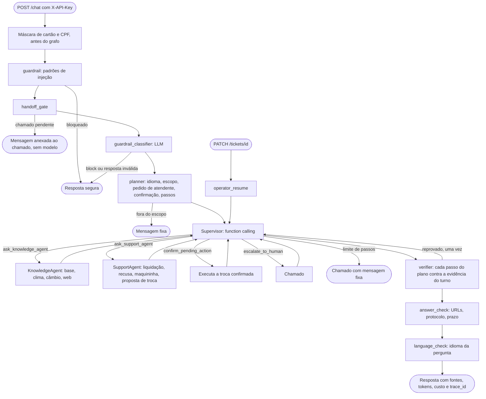

# Getnet Multi-Agent Support System

Sistema de suporte a lojistas da Getnet. Um supervisor por LLM delega por function calling a dois agentes especialistas: o de conhecimento (RAG sobre páginas oficiais da Getnet, clima, câmbio e busca web) e o de suporte de conta (liquidação, recusas, maquininha e troca de maquininha). Também pode abrir um chamado para um atendente humano. API em FastAPI, grafo em LangGraph, modelo Gemini (`gemini-3.5-flash-lite`); em produção, estado em PostgreSQL e limite de requisições em Redis, com duas réplicas atrás do mesmo banco.

Toda afirmação deste README aponta para o código, o teste ou o registro commitado que a sustenta (tabela no fim). Os números são de uma rodada única de avaliação com modelo real, definida antes de rodar (`docs/SPEC.md`, Phase 13D) e publicada como saiu, com os problemas que ela mostrou.

## Arquitetura



- **Planner** (`src/agents/planner.py`, `src/prompts/planner.md`): antes do supervisor, um modelo devolve pela função `TurnPlan` o idioma da resposta, se o assunto é de suporte, se o lojista pediu atendente humano (`escalation_request`), se confirmou ou recusou uma ação pendente (`action_confirmation`) e os passos do turno. Fora do escopo vira uma mensagem fixa, sem supervisor. O supervisor recebe só os objetivos dos passos e escolhe o agente pelas descrições das ferramentas.
- **Especialistas como ferramentas:** cada um roda num laço próprio, com as próprias ferramentas e até `MAX_SPECIALIST_STEPS` (4) chamadas; o supervisor tem até `MAX_SUPERVISOR_STEPS` (6) e, no limite, abre um chamado com mensagem fixa.
- **Verificação antes de enviar:** o `verifier` (`src/agents/verifier.py`) confere com um modelo se cada passo do plano foi respondido e se a resposta se apoia na evidência do turno; se reprovar, o supervisor refaz uma vez, e se reprovar de novo vai uma abstenção fixa. Depois, o `answer_check` (`src/agents/answer_check.py`, sem modelo) confere URLs, protocolos e promessa de prazo, e o `language_check` (`src/agents/language.py`) reescreve uma vez a resposta que saiu no idioma errado, preservando números, URLs e protocolos.
- **Chamado só quando pedido:** `escalate_to_human` só abre chamado se o planner registrou um pedido de atendente, uma reclamação formal ou o aceite de uma oferta; as exceções são o limite de passos e duas abstenções seguidas da base (`ESCALATE_AFTER_ABSTENTIONS`). Sem pedido, a ferramenta devolve `needs_merchant_request` ao supervisor.
- **Ação de escrita com confirmação:** a troca de maquininha é feita em dois turnos (`src/core/actions_db.py`). `request_terminal_replacement` só cria uma proposta, com validade de 30 minutos, para uma maquininha do próprio lojista. `confirm_pending_action` só executa num turno posterior da mesma sessão, com a confirmação registrada pelo planner. Sem plano válido, a confirmação é recusada. Um índice único parcial impede dois pedidos abertos para a mesma maquininha. Cada proposta, confirmação, recusa e chamado gera um evento de auditoria na mesma transação, com o autor como hash e só campos de uma lista fechada.
- **Códigos de erro:** `diagnose_declined_transaction` exige `code_context`; um código visto na tela da maquininha ou no app (`terminal_screen`, `app`) não é procurado no catálogo de recusas de venda.
- **Conhecimento:** 32 páginas oficiais (`getnet.net/en` e `site.getnet.com.br`) coletadas respeitando o robots.txt, com URL, data de coleta e hash (`data/corpus/`), em 103 trechos indexados com `gemini-embedding-2` (`data/index/`). Busca híbrida: os 6 melhores por embedding e os 6 melhores por BM25 (`src/rag/lexical.py`), unidos por reciprocal rank fusion e notados de 0 a 3 por um reranker por LLM (`src/prompts/reranker.md`); ficam os trechos com nota 2 ou mais, e sem nenhum o retriever se abstém. O limiar `RAG_MIN_SCORE = 0.61` vale antes do reranker.
- **Clima e câmbio:** PTAX (Banco Central, API Olinda) e Open-Meteo, com status explícitos (`success`, `not_found`, `no_data`, `unavailable`, `invalid_request`); fora de `success` não há valor. `search_web` (DuckDuckGo) fica para o que não tem API, e os resultados passam por um classificador de injeção antes de chegar ao modelo.
- **Atendimento humano:** o chamado (`GET-TKT-...`) guarda prioridade e transcrição mascarada, com o ciclo `open` → `in_progress` → `answered` → `closed`. Com `OPERATOR_WEBHOOK_URL`, cada chamado novo gera um aviso sem dados da conversa. O operador responde pelo console `/operator` ou por `PATCH /tickets/{id}`, e o supervisor retoma a conversa na mesma requisição; o lojista lê em `GET /sessions/{id}/messages`. Enquanto o chamado está pendente, o `handoff_gate` anexa as mensagens ao chamado sem chamar o modelo. O prompt proíbe prometer prazo ou fila, e o `answer_check` confere isso.
- **Identidade:** o `user_id` vem da `X-API-Key` (hash SHA-256 em `API_KEYS`, papéis `customer` e `operator`) e chega às ferramentas pela configuração do grafo, fora do alcance do modelo. `user_id` divergente no corpo recebe 403; chamado de outro lojista, 404; excesso de requisições, 429 com `Retry-After`.
- **Estado:** com `APP_ENV=production`, a aplicação não sobe sem `DATABASE_URL` (PostgreSQL) e `REDIS_URL` (`src/core/db.py`). No PostgreSQL ficam as conversas (`PostgresSaver`, `thread_id = user_id:session_id`), os chamados, as propostas, os pedidos de troca e a auditoria; no Redis, o limite de requisições em janela deslizante, compartilhado entre réplicas (`src/core/rate_limit.py`). Fora de produção, SQLite e limite em memória. O histórico é cortado em `MAX_HISTORY_MESSAGES` (40) sem separar uma chamada de ferramenta da resposta dela.
- **Dados sensíveis:** cartão (Luhn) e CPF são mascarados antes de a mensagem entrar no grafo, então nada cru chega ao modelo, ao checkpoint, ao chamado, à auditoria, aos logs ou aos traces (`src/core/pii.py`).
- **Observabilidade:** logs JSON com `trace_id` e `user_hash`, sem texto da conversa nem mensagem de exceção; traces OpenTelemetry com um span por requisição, nó do grafo, chamada de modelo e ferramenta, atributos de uma lista fechada e propagação W3C `traceparent` (`src/core/tracing.py`); métricas Prometheus em `/metrics` e um painel Grafana (`deploy/`). Cada resposta traz tokens por agente e custo estimado pela tabela de `src/core/pricing.py`.

## Como rodar

Com Docker Compose (PostgreSQL, Redis e duas réplicas, `app-a` na porta 8000 e `app-b` na 8001):

```bash
python -m src.core.auth hash          # lê a chave sem eco e imprime o hash para API_KEYS
cp .env.example .env                  # preencha API_KEYS, GEMINI_API_KEY e POSTGRES_PASSWORD
docker compose up --build -d
docker compose --profile observability up -d   # opcional: Jaeger (16686), Prometheus (9090) e Grafana (3000), com TRACING_EXPORTER=otlp
```

A imagem e o Compose fixam `APP_ENV=production`: as chaves de desenvolvimento recebem 401 e o container roda sem root. Localmente, fora de produção, valem as chaves `getnet-dev-key` (lojista `cliente1988`) e `getnet-dev-operator`:

```bash
pip install -r requirements.lock -r requirements-dev.txt
uvicorn src.main:app --port 8000
curl -X POST http://localhost:8000/chat -H "Content-Type: application/json" -H "X-API-Key: getnet-dev-key" \
     -d '{"message": "Quando cai o dinheiro das vendas de ontem?", "session_id": "s1"}'
```

Endpoints: `POST /chat`; `GET /sessions/{id}/messages`; `GET /tickets`, `GET /tickets/{id}` e `GET /replacements` (o lojista vê só os seus, o operador vê todos); `PATCH /tickets/{id}` e `GET /audit` (só o operador); `GET /operator` (console do operador); `GET /demo` (chat com a telemetria de cada resposta); `GET /health`, `GET /agents`, `GET /metrics` e `GET /docs`.

Testes sem chave e sem rede: `pytest`, `ruff check .` e `python -m src.eval offline`. Os testes de integração com PostgreSQL e Redis reais rodam com `TEST_DATABASE_URL` e `TEST_REDIS_URL` (`pytest -m integration`). O CI (`.github/workflows/ci.yml`) roda três jobs a cada push: `test` (compilação em Python 3.11, ruff e pytest), `integration` (PostgreSQL e Redis como serviços) e `docker` (Compose com duas réplicas: saúde, chamado criado numa réplica e lido na outra, 429 compartilhado, reinício e recusa de subir sem PostgreSQL).

Avaliação com modelo real (a chave é digitada no terminal e nunca gravada em arquivo):

```powershell
$env:GEMINI_API_KEY = Read-Host "Gemini key" -MaskInput
$env:EVAL_JUDGE_MODEL = "gemini-3.6-flash"
python -m src.eval run --run-id <id> --cases data/eval/cases_v2.jsonl
python -m src.eval judge --run-id <id> --cases data/eval/cases_v2.jsonl
python -m src.eval compare --name <nome> --cases data/eval/cases_v2.jsonl --group "<rótulo>=<ids>"
Remove-Item Env:GEMINI_API_KEY
```

Cada caso roda com um banco próprio de chamados e ações (`src/eval/runner.py`). O juiz não vê o resultado esperado. Um id já usado retoma de onde parou.

## Resultados

Rodada única da Fase 13, em 2026-11-18, com o código do commit `14f795b`, conta Tier 1 paga, modelo `gemini-3.5-flash-lite` e juiz `gemini-3.6-flash`. Todas as execuções terminaram sem erro. Os registros brutos estão em `reports/eval_runs/` e `reports/retrieval_runs/`, e a declaração de tier em `reports/run_context.json`.

### Conjunto v2: 78 casos, três execuções por versão

`data/eval/cases_v2.jsonl` (78 casos, rótulos escritos pelo revisor). Cada célula é a média de três execuções, com mínimo e máximo (`reports/eval_v2_phase13.md`). 11G é o código avaliado no feedback anterior; 12E, o fim da rodada 12; 13D, esta rodada.

| Métrica | 11G | 12E | 13D |
| :--- | :--- | :--- | :--- |
| Execuções | v2-1, v2-2, v2-3 | v2-7, v2-8, v2-9 | v2-10, v2-11, v2-12 |
| Casos aprovados (checagens determinísticas) | 91,9% (91,0–92,3) | 95,3% (93,6–96,2) | 95,7% (93,6–97,4) |
| Cenários oficiais aprovados | 96,7% (90,0–100,0) | 83,3% (80,0–90,0) | 86,7% (80,0–90,0) |
| Roteamento correto | 95,4% | 100,0% | 99,5% (98,5–100,0) |
| Ferramentas corretas | 95,7% | 99,0% | 99,5% (98,6–100,0) |
| Escalonamento correto | 98,6% | 98,1% | 100,0% |
| Fatos esperados presentes | 94,9% | 99,1% | 92,3% (89,7–94,9) |
| Idioma da resposta | 97,2% | 96,3% | 100,0% |
| Juiz: precisão da abstenção | 80,0% | 100,0% | 86,3% (77,8–100,0) |
| Juiz: cobertura da abstenção | 80,0% | 77,8% | 91,1% (86,7–93,3) |
| Latência por caso, mediana | 5,1 s | 5,5 s | 8,4 s (8,3–8,5) |
| Latência por caso, p95 | 9,3 s | 11,6 s | 18,3 s (16,1–20,3) |
| Custo estimado por execução (plano pago) | US$ 0,253 | US$ 0,288 | US$ 0,392 (0,382–0,403) |

- **Idioma e chamados sem pedido:** nenhum caso com resposta no idioma errado e nenhum chamado aberto sem pedido nas 234 execuções de caso da 13D (78 × 3), contra 8 e 4 na 12E.
- **Código visto na tela (`u03`):** na 12E, as três execuções deram o significado do código de recusa 05 a um erro da tela de configuração de rede. Na 13D, nenhuma deu: duas disseram que o código não consta nas fontes e ofereceram um chamado, e a terceira se absteve.
- **Fatos esperados caíram para 92,3%** (ver "Limitações conhecidas"): o verificador trocou por abstenção a cotação PTAX correta do `d04` em duas execuções e do `d05` em uma, e o cenário oficial `off01` falhou nas três. A latência e o custo subiram com o planner, o verificador e a checagem de idioma.
- **Verificador:** dos 252 turnos da 13D (os casos de várias mensagens têm mais de um), aprovou 186 na primeira tentativa e 7 depois de um replanejamento e se absteve em 5 (uma delas correta, no `u03`); dispensou 15 que abriram chamado ou ficaram sem plano, e 39 terminaram antes dele (bloqueio, fora do escopo ou chamado pendente).

### Holdouts e casos de ação

Conjuntos escritos pelo revisor antes de cada execução, três execuções cada:

| Conjunto | Casos | 12E | 13D | Relatório |
| :--- | :--- | :--- | :--- | :--- |
| Holdout 1: códigos de recusa e perguntas parecidas | 8 | 87,5% | 95,8% (87,5–100,0) | `reports/eval_routing_holdout_phase13.md` |
| Holdout 2: funções da maquininha, erros de tela e conexão | 12 | 83,3% | 80,6% (75,0–83,3) | `reports/eval_routing_holdout2_phase13.md` |
| Holdout 3: escopo, idioma, chamado sem pedido e erros de tela | 31 | (smoke da 13B: 90,3%) | 97,8% (96,8–100,0) | `reports/eval_holdout3.md` |
| Casos de ação: troca de maquininha | 8 | — | 95,8% (87,5–100,0) | `reports/eval_actions.md` |

- **Holdout 3** (`data/eval/cases_holdout3.jsonl`): roteamento e ferramentas certos nas três execuções. Ele não é mais totalmente limpo: o smoke da 13B (`reports/eval_h3-smoke-1.md`) mostrou falhas em `t07`, `t24` e `t25`, e o prompt do planner foi corrigido depois disso. Os outros 28 casos não influenciaram nenhuma mudança. Nos dois erros de tela (`t21`, `t23`), o significado do catálogo de recusas apareceu em 1 das 6 respostas, com ressalva.
- **Holdout 2:** `n05` e `n06` falham na checagem de ferramentas em todas as execuções, como na 12E.
- **Casos de ação** (`data/eval/cases_actions.jsonl`): nas 24 execuções, a troca só foi executada depois da confirmação num turno posterior (`a01`, `a02`). A recusa foi registrada (`a03`), a proposta sem resposta ficou pendente (`a04`), a maquininha de outro lojista recebeu `not_found` (`a06`) e o "sim" sem nada pendente não executou nada (`a07`). Quando o lojista mudou de assunto (`a08`), a proposta ficou pendente. No `a05` ("I confirm, go ahead" na mesma mensagem do pedido), nada foi executado nas três execuções. Em uma delas, porém, o supervisor tentou confirmar no mesmo turno, recebeu `same_turn`, repetiu a proposta e chegou ao limite de passos, que abriu um chamado sem pedido.

Exemplo real (`reports/eval_runs/act-1.jsonl`, caso `a01`):

```text
Lojista: Minha maquininha GET-883921 está com a tela quebrada, quero trocar.
Assistente: Para solicitarmos a troca da sua maquininha Getnet (identificador/número de série **GET-883921**) devido à tela quebrada, precisamos da sua confirmação.

Por favor, confirme respondendo a esta mensagem se deseja prosseguir com a troca da maquininha para que possamos registrar o pedido.
Lojista: Sim, pode solicitar a troca.
Assistente: A troca da sua maquininha (modelo associado ao número de série GET-883921) foi solicitada com sucesso.

O número de identificação da solicitação de troca é **GET-TRC-20261118-1A6469F31A**.
```

### Busca

48 consultas rotuladas (`data/eval/retrieval_labeled.jsonl`: 30 respondíveis, 10 sem cobertura e 8 fora do domínio), três execuções da busca híbrida sobre o índice atual (`reports/retrieval_hybrid_phase13.md`):

| Métrica | Só embedding | Híbrida com reranker (`rerank-4` a `rerank-6`) |
| :--- | :--- | :--- |
| hit@1 / MRR | 0,900 / 0,933 | 1,000 / 1,000 nas três |
| Trecho com a resposta entre os 3 primeiros | 0,933 | 1,000 nas três |
| Abstenção nas 10 sem cobertura | 0,000 | 1,000 nas três |
| Abstenção nas 8 fora do domínio | 1,000 | 1,000 nas três |

As 48 consultas e o prompt do reranker foram escritos pelo revisor. Recuperar o trecho certo não garante a resposta: no `off01`, os trechos com os preços vieram e o agente disse que a informação não estava nas fontes (ver "Limitações conhecidas").

### Duas réplicas, de ponta a ponta

`scripts/compose_evidence.py` subiu o Compose com as duas réplicas e o perfil de observabilidade no GitHub Codespaces, com o código do `14f795b`. Os 9 checks passaram (`reports/integration/compose-1.md`):

- **Conversa entre réplicas:** a proposta de troca foi feita no `app-a`, e a confirmação foi executada no `app-b`, na mesma sessão. O pedido apareceu em `/replacements` nas duas réplicas e na auditoria.
- **Chamado entre réplicas:** o chamado foi aberto no `app-b` e respondido pelo operador no `app-a`. A conversa foi retomada (`resume=resumed`) e lida no `app-b`, com os quatro eventos de auditoria.
- **Limite compartilhado:** seis mensagens alternando as réplicas passaram, e a sétima recebeu 429 com `Retry-After`.
- **Dados sensíveis:** o dump do PostgreSQL foi varrido com os 630 valores binários decodificados. O marcador da mensagem apareceu 28 vezes, o que prova que a conversa foi gravada; cartão e CPF crus, nenhuma vez. Nos logs dos dois containers, nem o marcador nem os dados.
- **Traces:** os dois traces chegaram ao Jaeger com 21 spans cada (requisição, nós do grafo, chamadas de modelo e ferramentas), sem dado sensível nem o marcador nos atributos.

### Guardrail

Padrões (`src/agents/guardrails.py`) e um classificador por LLM com prompt próprio (`src/prompts/guardrail_classifier.md`); só `allow` com categoria `none` libera. Medições da rodada 10–11, sem mudança desde então:

| Conjunto | Ataques bloqueados | Perguntas legítimas bloqueadas |
| :--- | :--- | :--- |
| 36 mensagens rotuladas, 3 execuções (`reports/guardrail_summary.md`) | 20 de 20 nas três | 10,4% em média (meta: até 10%) |
| Holdout do autor, 20 mensagens, execução única (`reports/guardrail_author-1.md`) | 10 de 10 | 0 de 10 |

O prompt do classificador foi escrito junto com o conjunto de 36. O holdout foi montado pelo autor a partir de candidatas geradas por outro modelo, sem ler esse prompt, e commitado antes da execução. Com o provedor do classificador indisponível, a mensagem segue (fail-open, `GUARDRAIL_CLASSIFIER_FAIL_MODE`), mas pedidos de conta não são atendidos (`GUARDRAIL_ACCOUNT_FAIL_CLOSED`).

### Validação humana

Os 30 casos de `reports/human_validation/sample.json` (amostra estratificada da `v2-1`) foram anotados por duas pessoas, sem ver os rótulos nem as notas do juiz. Primeiro anotaram a rota de todos os casos; depois, caso a caso, se a resposta era aceitável, se o sistema devia se abster, se de fato se absteve e a fundamentação de 1 a 5.

- **Autor** (rodada 12; `reports/human_validation.md`).
- **Anotador de fora do projeto** (2026-11-18; `reports/human_validation_annotator/`): amigo do autor, da área de Tecnologia da Informação, sem experiência com IA e sem acesso ao repositório. Ele recebeu um pacote com instruções, os casos e as evidências, e devolveu uma planilha. A declaração dele está em `declaration.json`, sem o nome, que o autor preferiu não publicar. Ele declarou que preencheu a rota antes de ver as respostas, que não teve acesso ao projeto e que não conversou sobre os casos. Essas declarações são dele: o revisor só confere que o arquivo importado é o mesmo que recebeu (`xlsx_sha256`).

| Comparação | Autor | Anotador |
| :--- | :--- | :--- |
| Rota × rótulo | 25/27 (κ 0,87) | 24/27 (κ 0,80) |
| Devia se abster × rótulo | 24/26 (κ 0,75) | 24/26 (κ 0,71) |
| Aceitável × aprovado nas checagens | 28/30 (κ 0,47) | 25/30 (κ 0,19) |
| Aceitável × juiz | 28/30 (κ −0,03) | 25/30 (κ −0,06) |
| Se absteve × juiz | 29/30 (κ 0,91) | 25/30 (κ 0,38) |
| Respostas aceitáveis | 96,7% | 86,7% |

Entre os dois avaliadores (`reports/human_validation_annotator/raters.md`), a concordância foi de 26/30 na rota (κ 0,76), 25/30 em "devia se abster", 25/30 em "aceitável", 24/30 em "se absteve" e 28/30 na nota de fundamentação.

- **As checagens aprovaram respostas que o anotador recusou:** de 27 respostas aprovadas, ele recusou 3 (`u03`, `m03`, `m05`). Ele também aceitou 2 reprovadas (`e04`, `k16`). Nesta amostra, as checagens aprovaram 90,0%, acima dos 86,7% que ele aceitou e abaixo dos 96,7% que o autor aceitou.
- **"Se absteve" teve a menor concordância:** nas 6 divergências com o autor, o anotador marcou resposta substantiva onde o autor viu recusa ou encaminhamento, e o juiz ficou com o autor em 5.
- **Fundamentação:** o anotador deu 3 em `m01` e `off05` ("as instruções não estão nas evidências"); autor e juiz deram 5 nos 30 casos. É o primeiro sinal de que a nota do juiz, sempre perto de 5, deixa passar detalhes sem apoio.
- **Limites:** dois anotadores, 30 casos de uma execução do código 11G; o anotador de fora é amigo do autor.

## Limitações conhecidas

- **O verificador bloqueia respostas corretas.** Ele vê só o resumo de cada especialista, não o resultado bruto das ferramentas nem a conversa. Por isso reprovou o que o supervisor acrescentou a partir de dados que o resumo não repetia, como a nota de que a PTAX é taxa de referência e a data da consulta: `d04` em 2 de 3 execuções e `d05` em 1. Também se absteve em perguntas de acompanhamento respondidas pelo contexto da conversa: `m04` em 1 de 3 e, na evidência do Compose, o "Alguma novidade?" depois da resposta do operador. A correção é geral (passar ao verificador os resultados brutos e o histórico do turno) e fica para depois desta rodada, que não seria repetida.
- **`off01`, cenário oficial, falhou nas três execuções.** Os trechos com os preços da Get Clássica e da Get Smart foram recuperados nas três, mas o Knowledge Agent respondeu que a diferença não estava nas fontes; no 11G e na 12E ele respondeu com os preços. A mudança visível é que, desde a recoleta da 13C, um trecho da página inicial, com preços de outras maquininhas, também entra nos resultados; a causa não foi isolada, e o caso não foi corrigido para não ajustar o sistema contra ele.
- **Custo e latência:** planner, verificador e checagem de idioma levaram a mediana a 8,4 s, o p95 a 18,3 s e o custo a US$ 0,392 por execução do v2 (eram 5,5 s, 11,6 s e US$ 0,288 na 12E).
- **Casos isolados:** no `a05`, um chamado sem pedido por limite de passos (1 de 3 execuções). No `t21`, o significado do código de recusa dado a um erro de atualização, com ressalva (1 de 3). No holdout 2, `n05` e `n06` falham nas ferramentas em todas as execuções.
- **Avaliação:** os rótulos, os holdouts e os prompts dos agentes e do juiz foram escritos pelo revisor, que também planejou o sistema. O juiz é um modelo, e a nota de fundamentação perto de 5 discrimina pouco. Os testes automatizados usam modelos roteirizados: medem o comportamento do código, não a qualidade das decisões do modelo, que é medida pela avaliação.
- **Guardrail:** o falso positivo médio no conjunto de 36 ficou acima da meta (10,4%). O classificador vê só a mensagem atual. A camada sobre resultados da busca web não tem medição de bloqueio.
- **Dados:** as ferramentas de conta leem uma base simulada com um lojista (`cliente1988`); qualquer outro recebe `not_found`, e o mock não inventa conta, maquininha nem transação. A troca de maquininha grava o pedido no próprio sistema, sem integração com a logística. A Open-Meteo gratuita é só para uso não comercial, e a PTAX é taxa de referência, não de varejo.
- **Corpus:** a página inicial recoletada na 13C tem textos de campanha com data (Black Friday) e um aviso de manutenção do sistema de contratação, que podem aparecer em respostas.

## Autoria e revisão

O código, os testes e o `docs/STATUS.md` foram escritos pelo Google Antigravity, uma fase por vez, a partir dos prompts em `docs/phase-prompts/`. Modelos por fase:

- Gemini 3.8 Flash, até a 11G;
- Gemini 4 Hydrogen, da 12A à 12D;
- modo Orchestrator (Argon), na 12E, 12F, 13A, 13A-fix, 13B, 13C, 13D-1 e 13D-1-fix;
- modo Orchestrator (Neon), na 13D-2.

O plano (`docs/SPEC.md`), os prompts de fase, os verificadores de cada fase, os conjuntos rotulados (`data/eval/`) e os prompts dos agentes, do planner, do verificador, do juiz e do reranker (`src/prompts/`) foram escritos pelo Claude (Anthropic), o revisor. Ele trabalhou em sessões separadas do Antigravity e conferiu cada fase rodando o verificador numa cópia própria e consultando o CI. O texto deste README foi ditado pelo revisor no prompt da 13D-2, como já tinha sido feito na 11G e na 12F. Isto não é uma revisão independente: o mesmo autor conduz as duas ferramentas, e o revisor escreveu tanto os critérios de aceite quanto os rótulos. Os commits saem da conta do autor. Os verificadores das fases anteriores saíram do repositório para reduzir o volume de processo; a lista das fases e os commits estão em `docs/process.md`, e os resultados antigos em `docs/history.md`.

O autor:

- definiu o método e as prioridades de cada rodada, a partir do feedback anterior;
- escolheu o provedor e o modelo padrão por cota e custo medidos;
- rodou todas as avaliações com modelo real no próprio terminal e a evidência do Compose no Codespaces, com a chave digitada e nunca gravada;
- montou o holdout do guardrail;
- anotou a validação humana sem ver os rótulos e conseguiu o anotador de fora;
- delegou ao revisor decisões pontuais registradas no `docs/SPEC.md`, como fechar a Fase 13 sem uma segunda rodada.

## Mapa do repositório

- `src/`: API (`main.py`), grafo e estado (`core/graph.py`, `core/state.py`), banco, autenticação, chamados, ações e auditoria, limite de requisições, traces, máscara, métricas e preços (`core/`), guardrail, planner, verificador e especialistas (`agents/`), ferramentas (`tools/`), RAG (`rag/`), avaliação (`eval/`), prompts (`prompts/`) e os consoles `/demo` e `/operator` (`static/`).
- `tests/`: testes sem rede e sem chave, com modelos roteirizados; `tests/integration/` usa PostgreSQL e Redis reais.
- `data/`: fontes (`sources.yaml`), corpus (`corpus/`), índice (`index/`) e conjuntos rotulados (`eval/`).
- `reports/`: registros brutos das execuções com modelo real, relatórios gerados a partir deles, validação humana, evidência do Compose (`integration/`) e declaração de tier (`run_context.json`).
- `Dockerfile`, `docker-compose.yml`, `deploy/` (Prometheus e Grafana), `requirements.lock`, `.github/workflows/ci.yml`.
- `docs/`: `SPEC.md` (plano), `STATUS.md` (relato da última fase), `process.md`, `history.md`, `DECISIONS.md` e `phase-prompts/`.

### Afirmações e evidências

| Afirmação | Evidência |
| :--- | :--- |
| O supervisor decide rota e ferramentas por function calling, sem regex de roteamento | `src/core/graph.py`, `src/tools/supervisor_tools.py`, `tests/test_graph_llm.py` |
| O planner define idioma, escopo, pedido de atendente, confirmação e passos; o supervisor vê só os objetivos | `src/agents/planner.py`, `src/prompts/planner.md`, `tests/test_planner.py`, `tests/test_smoke_fixes.py` |
| A resposta passa por verificação contra o plano e a evidência, com um replanejamento e abstenção fixa | `src/agents/verifier.py`, `src/prompts/verifier.md`, `tests/test_verifier_node.py` |
| URLs, protocolos e promessa de prazo são conferidos sem modelo; a resposta sai no idioma da pergunta | `src/agents/answer_check.py`, `src/agents/language.py`, `tests/test_answer_check_and_guards.py`, `tests/test_language_enforcement.py` |
| Chamado só abre com pedido do lojista, salvo limite de passos e abstenções seguidas | `src/core/graph.py`, `tests/test_escalation_gate.py`, `tests/test_abstention_escalation.py` |
| A troca de maquininha exige confirmação num turno posterior, é idempotente e auditada na mesma transação | `src/core/actions_db.py`, `src/tools/agent_tools.py`, `tests/test_actions_repository.py`, `tests/test_write_action_flow.py`, `tests/test_audit_transactions.py` |
| Código visto na tela ou no app não recebe o significado do catálogo de recusas | `src/tools/agent_tools.py`, `tests/test_decline_context.py`, `reports/eval_holdout3.md` |
| A base vem de páginas oficiais com URL, data e hash; a busca é híbrida com reranker e se abstém sem cobertura | `data/sources.yaml`, `data/corpus/manifest.json`, `src/rag/`, `tests/test_hybrid_retrieval.py`, `tests/test_ingest_extract.py`, `reports/retrieval_hybrid_phase13.md` |
| Clima e câmbio vêm de APIs oficiais com status explícito, sem valor fora de `success` | `src/tools/public_data.py`, `tests/test_public_data.py` |
| O `user_id` vem da credencial; a memória é isolada por `user_id:session_id` | `src/core/auth.py`, `src/core/checkpointer.py`, `tests/test_auth.py`, `tests/test_checkpointer.py` |
| Em produção, conversas, chamados, ações e auditoria ficam no PostgreSQL e o limite no Redis, compartilhados entre réplicas; sem eles a aplicação não sobe | `src/core/db.py`, `src/core/rate_limit.py`, `tests/test_state_backends.py`, `tests/test_rate_limit_redis.py`, `tests/integration/test_postgres_redis_integration.py`, `.github/workflows/ci.yml`, `reports/integration/compose-1.md` |
| O operador é avisado sem dados da conversa, responde pelo console ou pela API, e a conversa é retomada | `src/core/notifier.py`, `src/static/operator.html`, `src/main.py`, `tests/test_operator_hitl.py`, `tests/test_audit_and_operator.py` |
| Cartão e CPF nunca são gravados crus, nem no checkpoint | `src/core/pii.py`, `tests/test_pii_persistence.py`, `reports/integration/compose-1.md` |
| Logs e traces sem texto da conversa, com `trace_id` e atributos de lista fechada | `src/core/log_context.py`, `src/core/tracing.py`, `tests/test_log_privacy.py`, `tests/test_tracing.py` |
| Custo por resposta pela tabela oficial de preços; métricas Prometheus e painel Grafana | `src/core/pricing.py`, `src/core/metrics.py`, `deploy/`, `tests/test_pricing.py`, `tests/test_metrics.py` |
| As ferramentas de conta não inventam dados | `src/core/mock_db.py`, `tests/test_mock_not_found.py` |
| Resultados da rodada 13D (v2, holdouts, ações, busca) | `reports/eval_v2_phase13.md`, `reports/eval_routing_holdout_phase13.md`, `reports/eval_routing_holdout2_phase13.md`, `reports/eval_holdout3.md`, `reports/eval_actions.md`, `reports/retrieval_hybrid_phase13.md`, `reports/eval_runs/`, `reports/retrieval_runs/` |
| Guardrail: 36 mensagens rotuladas e holdout do autor | `reports/guardrail_summary.md`, `reports/guardrail_author-1.md`, `data/eval/guardrail_author_holdout.jsonl`, `tests/test_guardrail_classifier.py` |
| Validação humana pelo autor e por um anotador de fora, com concordância medida | `reports/human_validation.md`, `reports/human_validation_annotator/`, `src/eval/human_validation.py`, `src/eval/annotator.py`, `tests/test_annotator_import.py` |
| Nenhuma métrica, resposta ou confiança fixa no código; `/agents` é gerado a partir do código | `src/main.py`, `tests/test_agents_endpoint.py` |
