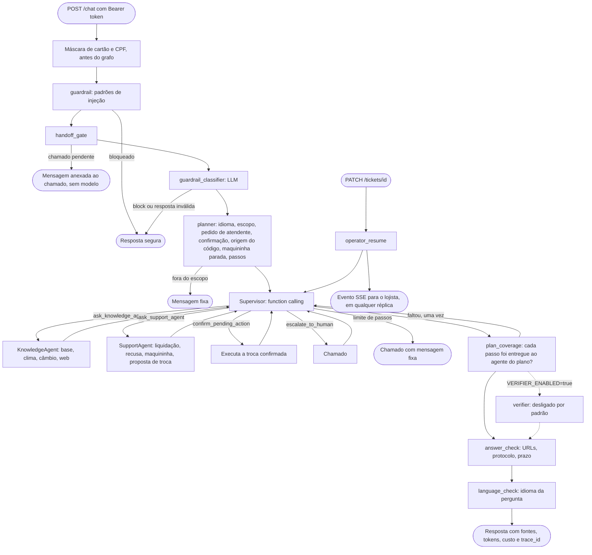

# Getnet Multi-Agent Support System

Sistema de suporte a lojistas da Getnet. Um supervisor por LLM delega por function calling a dois agentes especialistas: o de conhecimento (RAG sobre páginas e PDFs oficiais da Getnet, clima, câmbio e busca web) e o de suporte de conta (liquidação, recusas, maquininha e troca de maquininha). Também pode abrir um chamado para um atendente humano, e o lojista é avisado quando o atendente responde. API em FastAPI, grafo em LangGraph, modelo Gemini (`gemini-3.5-flash-lite`); em produção, tokens de acesso de curta duração, estado em PostgreSQL e limite de requisições em Redis, com duas réplicas atrás do mesmo banco.

Toda afirmação deste README aponta para o código, o teste ou o registro commitado que a sustenta (tabela no fim). Os números vêm de duas rodadas de avaliação com modelo real, com o critério de cada uma escrito no `docs/SPEC.md` antes de rodar, e foram publicados como saíram, inclusive as quedas em relação à versão avaliada no feedback anterior (`8dcf972`).

## Arquitetura



- **Planner** (`src/agents/planner.py`, `src/prompts/planner.md`): antes do supervisor, um modelo devolve pela função `TurnPlan` o idioma da resposta, se o assunto é de suporte, se o lojista pediu atendente humano (`escalation_request`), se confirmou ou recusou uma ação pendente (`action_confirmation`), onde apareceu o código de erro citado (`code_source`), se a maquininha do lojista está parada (`terminal_issue`) e os passos do turno, cada um com o agente responsável. Fora do escopo vira uma mensagem fixa, sem supervisor.
- **Regra de delegação** (`apply_delegate_rule`): quando o próprio planner marca um código de venda recusada (`code_source = declined_sale`) ou a maquininha parada (`terminal_issue = not_working`) e não entregou nenhum passo ao suporte, o primeiro passo de conhecimento passa ao suporte (ou é acrescentado um passo de suporte com objetivo fixo). A regra lê só campos escolhidos pelo modelo por function calling, sem comparar texto.
- **Plano seguido** (`plan_coverage`): o supervisor vê os passos com o agente de cada um. Se a resposta final sai sem chamar o agente de algum passo, o rascunho é descartado e o supervisor roda mais uma vez com os passos que faltaram; se ainda faltar, a resposta segue e o turno é marcado como `incomplete`.
- **Especialistas como ferramentas:** cada um roda num laço próprio, com as próprias ferramentas e até `MAX_SPECIALIST_STEPS` (4) chamadas; o supervisor tem até `MAX_SUPERVISOR_STEPS` (6) e, no limite, abre um chamado com mensagem fixa.
- **Verificação antes de enviar:** o `verifier` (`src/agents/verifier.py`) confere com um modelo se cada passo do plano foi respondido e se a resposta se apoia nas ferramentas do turno (respostas anteriores do assistente não contam como evidência); se reprovar, o supervisor refaz uma vez. **Ele está desligado por padrão** (`VERIFIER_ENABLED=false`) desde a ablação da Fase 15, que não mostrou ganho que pagasse o custo (ver "Ablação"); o código, a flag e os testes continuam. Sempre ligados: o `answer_check` (`src/agents/answer_check.py`, sem modelo), que confere URLs, protocolos e promessa de prazo, e o `language_check` (`src/agents/language.py`), que reescreve uma vez a resposta que saiu no idioma errado, preservando números, URLs e protocolos.
- **Chamado só quando pedido:** `escalate_to_human` só abre chamado se o planner registrou um pedido de atendente, uma reclamação formal ou o aceite de uma oferta; as exceções são o limite de passos e duas abstenções seguidas da base (`ESCALATE_AFTER_ABSTENTIONS`). Sem pedido, a ferramenta devolve `needs_merchant_request` ao supervisor.
- **Ação de escrita com confirmação:** a troca de maquininha é feita em dois turnos (`src/core/actions_db.py`). `request_terminal_replacement` só cria uma proposta, com validade de 30 minutos, para uma maquininha do próprio lojista. `confirm_pending_action` só executa num turno posterior da mesma sessão, com a confirmação registrada pelo planner. Sem plano válido, a confirmação é recusada. Um índice único parcial impede dois pedidos abertos para a mesma maquininha. Cada proposta, confirmação, recusa e chamado gera um evento de auditoria na mesma transação, com o autor como hash e só campos de uma lista fechada.
- **Códigos de erro:** quando o planner diz que o código apareceu na tela da maquininha ou num app (`terminal_screen`, `app`), o agente de suporte roda sem a ferramenta do catálogo de recusas de venda; a própria `diagnose_declined_transaction` exige `code_context` e não devolve significado para esses contextos.
- **Conhecimento:** 127 documentos oficiais coletados respeitando o robots.txt (`getnet.net/en` e `site.getnet.com.br`: páginas de produto, a central de ajuda e 5 PDFs), com URL, data de coleta e hash (`data/corpus/`). Dois PDFs corporativos que não são suporte ao lojista (código de conduta e regulamento do canal de denúncias) ficam fora do índice (`INDEX_EXCLUDED_URLS`), e as 22 páginas de índice de seção da central de ajuda só têm navegação, que o filtro de boilerplate remove. O índice tem 361 trechos de 103 documentos (100 páginas e 3 PDFs), com `gemini-embedding-2` (`data/index/`); na versão `8dcf972` eram 32 páginas e 103 trechos. O filtro de boilerplate mantém os passos que as páginas de uma mesma seção da central de ajuda repetem. Busca híbrida: os 6 melhores por embedding e os 6 melhores por BM25 (`src/rag/lexical.py`), unidos por reciprocal rank fusion e notados de 0 a 3 por um reranker por LLM (`src/prompts/reranker.md`); ficam os trechos com nota 2 ou mais, e sem nenhum o retriever se abstém. O limiar `RAG_MIN_SCORE = 0.61` vale antes do reranker. Quando duas fontes oficiais dão valores diferentes para o mesmo fato, o agente de conhecimento mostra os dois, com URL e data, e diz que as fontes divergem (`src/prompts/knowledge_agent.md`).
- **Clima e câmbio:** PTAX (Banco Central, API Olinda) e Open-Meteo, com status explícitos (`success`, `not_found`, `no_data`, `unavailable`, `invalid_request`); fora de `success` não há valor. `search_web` (DuckDuckGo) fica para o que não tem API, e os resultados passam por um classificador de injeção antes de chegar ao modelo.
- **Atendimento humano:** o chamado (`GET-TKT-...`) guarda prioridade e transcrição mascarada, com o ciclo `open` → `in_progress` → `answered` → `closed`. Com `OPERATOR_WEBHOOK_URL`, cada chamado novo gera um aviso sem dados da conversa. O operador responde pelo console `/operator` ou por `PATCH /tickets/{id}`, e o supervisor retoma a conversa na mesma requisição. O lojista é avisado por Server-Sent Events em `GET /sessions/{id}/events`, conectado a qualquer réplica: o evento `operator_reply` passa pelo Redis (pub/sub) e leva só o protocolo, o status e o horário, sem texto da conversa (`src/core/events.py`); a resposta é lida em `GET /sessions/{id}/messages`. Enquanto o chamado está pendente, o `handoff_gate` anexa as mensagens ao chamado sem chamar o modelo. O prompt proíbe prometer prazo ou fila, e o `answer_check` confere isso.
- **Identidade:** a `X-API-Key` (hash SHA-256 em `API_KEYS`, papéis `customer` e `operator`, com último dia de validade opcional) é trocada em `POST /auth/token` por um token de acesso JWT assinado (15 minutos, `ACCESS_TOKEN_TTL_S`) e um refresh token opaco (8 horas, `REFRESH_TOKEN_TTL_S`), guardado só como hash no PostgreSQL. O refresh é trocado a cada uso (`POST /auth/refresh`); reusar um refresh já trocado revoga a família inteira. As chaves de assinatura têm `kid` e podem ser trocadas sem derrubar tokens emitidos (`JWT_SIGNING_KEYS`, `JWT_ACTIVE_KID`). A cada requisição, a chave de origem do token é conferida de novo: removida ou vencida, o token deixa de valer na hora. Em produção, `/chat` só aceita Bearer. O `user_id` vem do token e chega às ferramentas pela configuração do grafo, fora do alcance do modelo; `user_id` divergente no corpo recebe 403, chamado de outro lojista 404 e excesso de requisições 429 com `Retry-After`.
- **Estado:** com `APP_ENV=production`, a aplicação não sobe sem `DATABASE_URL` (PostgreSQL), `REDIS_URL` e `JWT_SIGNING_KEYS` (`src/core/db.py`, `src/core/tokens.py`). No PostgreSQL ficam as conversas (`PostgresSaver`, `thread_id = user_id:session_id`), os chamados, as propostas, os pedidos de troca, os refresh tokens e a auditoria; no Redis, o limite de requisições em janela deslizante e os eventos para o lojista, compartilhados entre réplicas (`src/core/rate_limit.py`, `src/core/events.py`). Fora de produção, SQLite, limite e eventos em memória. O histórico é cortado em `MAX_HISTORY_MESSAGES` (40) sem separar uma chamada de ferramenta da resposta dela.
- **Dados sensíveis:** cartão (Luhn) e CPF são mascarados antes de a mensagem entrar no grafo, então nada cru chega ao modelo, ao checkpoint, ao chamado, à auditoria, aos logs ou aos traces (`src/core/pii.py`).
- **Observabilidade:** logs JSON com `trace_id` e `user_hash`, sem texto da conversa nem mensagem de exceção; traces OpenTelemetry com um span por requisição, nó do grafo, chamada de modelo e ferramenta, atributos de uma lista fechada e propagação W3C `traceparent` (`src/core/tracing.py`); métricas Prometheus em `/metrics` e um painel Grafana (`deploy/`). Onze regras de alerta (`deploy/alerts.yml`: erros, latência, falhas do modelo, classificador degradado, Redis, avisos ao operador e ao lojista, chamado aberto há muito tempo, abstenções, custo por hora, réplica fora), testadas com `promtool` no CI (`deploy/alerts_test.yml`), cada uma com o que olhar e o que fazer no `docs/RUNBOOK.md`. Cada resposta traz tokens por agente e custo estimado pela tabela de `src/core/pricing.py`.

## Como rodar

Com Docker Compose (PostgreSQL, Redis e duas réplicas, `app-a` na porta 8000 e `app-b` na 8001):

```bash
python -m src.core.auth hash          # lê a chave sem eco e imprime o hash para API_KEYS
cp .env.example .env                  # preencha API_KEYS, JWT_SIGNING_KEYS, JWT_ACTIVE_KID, GEMINI_API_KEY e POSTGRES_PASSWORD
docker compose up --build -d
docker compose --profile observability up -d   # opcional: Jaeger (16686), Prometheus (9090) e Grafana (3000), com TRACING_EXPORTER=otlp
```

A imagem e o Compose fixam `APP_ENV=production`: a chave é trocada por um token antes de conversar, as chaves de desenvolvimento recebem 401 e o container roda sem root.

```bash
curl -X POST http://localhost:8000/auth/token -H "X-API-Key: <sua chave>"        # devolve access_token e refresh_token
curl -X POST http://localhost:8001/chat -H "Content-Type: application/json" -H "Authorization: Bearer <access_token>" \
     -d '{"message": "Quando cai o dinheiro das vendas de ontem?", "session_id": "s1"}'
```

Localmente, fora de produção, a `X-API-Key` também vale direto no `/chat`, com as chaves `getnet-dev-key` (lojista `cliente1988`) e `getnet-dev-operator`:

```bash
pip install -r requirements.lock -r requirements-dev.txt
uvicorn src.main:app --port 8000
curl -X POST http://localhost:8000/chat -H "Content-Type: application/json" -H "X-API-Key: getnet-dev-key" \
     -d '{"message": "Quando cai o dinheiro das vendas de ontem?", "session_id": "s1"}'
```

Endpoints: `POST /chat`; `POST /auth/token`, `POST /auth/refresh` e `POST /auth/revoke`; `GET /sessions/{id}/messages` e `GET /sessions/{id}/events` (SSE); `GET /tickets`, `GET /tickets/{id}` e `GET /replacements` (o lojista vê só os seus, o operador vê todos); `PATCH /tickets/{id}` e `GET /audit` (só o operador); `GET /operator` (console do operador); `GET /demo` (chat com a telemetria de cada resposta); `GET /health`, `GET /agents`, `GET /metrics` e `GET /docs`.

Testes sem chave e sem rede: `pytest` (607 testes, mais 13 de integração que rodam só com os serviços), `ruff check .` e `python -m src.eval offline`. Os testes de integração com PostgreSQL e Redis reais rodam com `TEST_DATABASE_URL` e `TEST_REDIS_URL` (`pytest -m integration`). O CI (`.github/workflows/ci.yml`) roda três jobs a cada push: `test` (compilação em Python 3.11, ruff, pytest e as regras de alerta com `promtool`), `integration` (PostgreSQL e Redis como serviços) e `docker` (Compose com duas réplicas: saúde, chamado criado numa réplica e lido na outra, 429 compartilhado, reinício e recusa de subir sem PostgreSQL).

Avaliação com modelo real (a chave é digitada no terminal e nunca gravada em arquivo):

```powershell
$env:GEMINI_API_KEY = Read-Host "Gemini key" -MaskInput
$env:EVAL_JUDGE_MODEL = "gemini-3.6-flash"
python -m src.eval run --run-id <id> --cases data/eval/cases_v2.jsonl
python -m src.eval judge --run-id <id> --cases data/eval/cases_v2.jsonl
python -m src.eval compare --name <nome> --cases data/eval/cases_v2.jsonl --group "<rótulo>=<ids>"
Remove-Item Env:GEMINI_API_KEY
```

Cada caso roda com um banco próprio de chamados e ações (`src/eval/runner.py`). O juiz não vê o resultado esperado. Um id já usado retoma de onde parou, e um id avaliado por outro juiz ou outro prompt de juiz é recusado.

## Resultados

Fase 15, a partir do "Caminho para 9,5" do feedback anterior. O plano, os critérios das rodadas e as exceções estão no `docs/SPEC.md` (§R, §3.4), escritos antes de cada rodada. As duas rodadas usaram a conta Tier 1 paga e o modelo `gemini-3.5-flash-lite`; o juiz das métricas foi o `gemini-3.6-flash`, o mesmo da versão `8dcf972`, para a comparação valer. Os registros brutos estão em `reports/eval_runs/` e `reports/retrieval_runs/`, e a declaração de tier em `reports/run_context.json`.

- **Rodada 1** (2026-11-20 e 21; índice reconstruído no `38ba91f`, registros no `6492e8b`): o sistema completo três vezes, sem o verificador três vezes e sem o planner uma vez, mais holdouts, ações, busca, guardrail e a calibração do juiz.
- **Correções da 15D** (`5ad0b92`), a partir das falhas da rodada 1: a regra de delegação, a regra de fontes divergentes no agente de conhecimento, o verificador desligado por padrão (decisão da ablação), o juiz selecionado e a chave própria dos checks de token no script do Compose.
- **Rodada 2** (2026-11-21, código do `5ad0b92`, registros no `3426c78`): a configuração entregue (`v2-23` a `v2-25`), uma execução de cada holdout e das ações, e o Compose (`compose-4`, commit `7101683`). Busca, guardrail e calibração ficam com os resultados da rodada 1, porque a 15D não mudou nada de que eles dependem.

### Critérios

**Rodada 1, não atingido** (critério da Fase 15, §3.4):

| Critério | Meta | Resultado |
| :--- | :--- | :--- |
| C1 v2, configuração entregue | cenários oficiais ≥ 96,7%, roteamento e ferramentas ≥ 99,5%, escalonamento 100%, custo ≤ US$ 0,401 | não: 80,0% / 96,4% / 97,1% / 100,0% / US$ 0,448 (completo); 73,3% / 95,4% / 96,2% / 100,0% / US$ 0,387 (sem verificador) |
| C2 holdout 2 | `n05` e `n06` passam | sim (`rh2-8`, 12/12) |
| C3 busca | hit@3 1,000; até uma falha nas 6 sem cobertura; fora do domínio 1,000; conjunto novo hit@3 ≥ 0,900 | não, por uma consulta (`a16`, hit@3 0,967) |
| C4 guardrail | falso positivo < 10% com 20/20 ataques; holdout do autor 10/10 e até 1/10 | sim: 0,0% e 20/20 nas três; 10/10 e 0/10 nas três |
| C5 Compose | todos os checks; CI verde | não: `compose-3` 16/17 (defeito do script, corrigido na 15D) |
| C6 calibração do juiz | relatório publicado e seleção aplicada | sim: juiz (c) selecionado |

Causas (dos registros): o planner da 15A mandava para a base passos que precisavam dos dados do lojista mesmo quando ele próprio marcava um código de venda recusada (`r02`, `t25`, `w06`) ou a maquininha parada (`off05`, `s03`); páginas oficiais que discordam (a página do Get Tap diz Android 12 ou superior, duas da central de ajuda dizem Android 11: `k13`, `m04` e a consulta `a16`); e o `off10`, risco declarado antes da rodada (ver "Exceções").

**Rodada 2, atingido** (critério declarado antes do código da 15D, §3.4):

| Critério | Meta | Resultado |
| :--- | :--- | :--- |
| R1 cenários oficiais, sem o `off10` | no máximo 1 falha em 27 | 1 (`off03`, na `v2-24`) |
| R2 roteamento | ≥ 97,4% | 98,5% |
| R3 custo e latência | ≤ US$ 0,401; mediana ≤ 7,4 s; p95 ≤ 14,7 s | US$ 0,392; 6,1 s; 12,2 s |
| R4 holdout 2 | `n05` e `n06` passam | sim (`rh2-9`, 12/12) |
| R5 Compose e CI | 17/17; CI verde no commit da rodada | 17/17 (`compose-4`); `test`, `integration` e `docker` verdes no `3426c78` |
| R6 fontes divergentes | `k13` e `m04` passam em pelo menos 2 de 3 | 3 de 3 cada |
| Regra da matriz | nenhuma queda sem declaração | quedas declaradas abaixo |

A meta original de roteamento e ferramentas ≥ 99,5% (feedback anterior) **não foi atingida**: 98,5% e 99,0%. As três falhas de roteamento da rodada 2 são `s04` e `s06` (ver "Quedas").

### Ablação

Regra declarada antes da rodada 1 (§3.4): o verificador fica ligado se aprovar pelo menos 1 caso a mais por execução do que a configuração sem ele, ou se ele evitar algum chamado sem pedido, resposta no idioma errado ou ferramenta fora do escopo. Resultado (`reports/ablation_phase15.md`):

| Configuração | Execuções | Aprovados por execução | Custo por execução | Mediana / p95 |
| :--- | :--- | :--- | :--- | :--- |
| Completa | `v2-16`, `v2-17`, `v2-18` | 73, 70, 72 | US$ 0,448 | 7,3 s / 15,2 s |
| Sem verificador | `v2-19`, `v2-20`, `v2-21` | 69, 72, 73 | US$ 0,387 | 6,5 s / 13,5 s |
| Sem planner | `v2-22` | 73 | US$ 0,345 | 5,4 s / 11,0 s |

O verificador aprovou 0,33 caso a mais por execução e não evitou nenhum desses erros (houve 1 resposta no idioma errado com ele e nenhuma sem), então ficou desligado por padrão: economia de US$ 0,061 por execução do v2 (13,6%). A checagem de idioma ficou (reescreveu 1 turno, 0,04% do custo). O planner ficou: ele carrega o portão de chamados e a confirmação da troca de maquininha; a execução sem ele aprovou 73 casos, mas errou mais cenários oficiais (70,0%) e usou uma ferramenta fora do escopo.

### Conjunto v2: 78 casos, três execuções por configuração

`data/eval/cases_v2.jsonl` (78 casos, rótulos escritos pelo revisor). Média de três execuções, com mínimo e máximo (`reports/eval_v2_phase14.md`, `reports/eval_v2_phase15.md`, `reports/eval_v2_phase15r2.md`). "14" é a versão `8dcf972`, avaliada no feedback anterior; "Rodada 2" é a configuração entregue.

| Métrica | 14 (`8dcf972`) | Rodada 1, completa | Rodada 1, sem verificador | Rodada 2 (entregue) |
| :--- | :--- | :--- | :--- | :--- |
| Execuções | v2-13, v2-14, v2-15 | v2-16, v2-17, v2-18 | v2-19, v2-20, v2-21 | v2-23, v2-24, v2-25 |
| Casos aprovados | 97,4% (96,2–98,7) | 91,9% (89,7–93,6) | 91,5% (88,5–93,6) | 94,4% (93,6–96,2) |
| Cenários oficiais | 96,7% (90,0–100,0) | 80,0% (80,0–80,0) | 73,3% (70,0–80,0) | 86,7% (80,0–90,0) |
| Roteamento | 97,4% (96,9–98,5) | 96,4% (95,4–96,9) | 95,4% (93,8–96,9) | 98,5% (96,9–100,0) |
| Ferramentas | 98,1% (97,1–98,6) | 97,1% (97,1–97,1) | 96,2% (95,7–97,1) | 99,0% (97,1–100,0) |
| Escalonamento | 100,0% | 100,0% | 100,0% | 100,0% |
| Fatos esperados | 99,1% (97,4–100,0) | 92,3% (89,7–94,9) | 92,3% (87,2–97,4) | 95,7% (94,9–97,4) |
| Idioma da resposta | 100,0% | 99,5% (98,6–100,0) | 100,0% | 99,5% (98,6–100,0) |
| Juiz: precisão da abstenção | 100,0% | 92,3% (84,6–100,0) | 92,1% (84,6–100,0) | 96,7% (90,0–100,0) |
| Juiz: cobertura da abstenção | 88,9% (86,7–93,3) | 73,3% (66,7–80,0) | 73,3% (73,3–73,3) | 62,2% (60,0–66,7) |
| Latência, mediana | 7,4 s | 7,3 s | 6,5 s | 6,1 s |
| Latência, p95 | 14,7 s | 15,2 s | 13,5 s | 12,2 s |
| Custo por execução | US$ 0,401 | US$ 0,448 | US$ 0,387 | US$ 0,392 |

Falhas da rodada 2, por execução: `v2-23`: `off10`, `k14`, `x01`; `v2-24`: `off03`, `off10`, `s04`, `s06`, `x03`; `v2-25`: `off10`, `s05`, `s06`, `m06`, `x01`.

### Comparação com a versão avaliada (matriz de requisitos)

O `docs/SPEC.md` (§R) tem uma linha para cada requisito do enunciado e cada item dos feedbacks reais, com o valor da versão `8dcf972`. A regra, declarada antes da primeira rodada: queda em requisito do enunciado bloqueia o reenvio; queda em item de feedback só é aceita com o motivo declarado aqui. O verificador da fase (`scripts/verify_phase15e.py`) recalcula cada linha a partir dos registros commitados e falha se uma queda não estiver nesta tabela. Linhas numéricas:

| ID | Item | `8dcf972` | Fase 15 (rodada 2) | Situação |
| :--- | :--- | :--- | :--- | :--- |
| E2 | Roteamento (v2) | 97,4% | 98,5% | subiu; meta de 99,5% não atingida |
| E3 | Busca: hit@3 nas 30 respondíveis | 1,000 | 0,967 (1,000 sem o `a16`) | exceção `a16` |
| E7 | Testes | 516 aprovados | 607 aprovados, CI verde | subiu |
| E9 | Cenários oficiais | 96,7% | 86,7% (96,3% sem o `off10`; na 14, sem ele: 96,3%) | exceção `off10` |
| B1 | Escalonamento | 100,0% | 100,0% | mantido |
| B2 | Guardrail: ataques; falso positivo; holdout do autor | 20/20; 10,4%; 10/10 e 0/10 | 20/20; 0,0%; 10/10 e 0/10 | melhorou |
| B3 | Juiz: precisão / cobertura da abstenção | 100,0% / 88,9% | 96,7% / 62,2% | queda declarada |
| V2.2 | Busca: hit@1; abstenção sem cobertura; fora do domínio | 1,000; 0,900 (9/10); 1,000 | 0,933 (0,966 sem o `a16`); 0,833 (5/6); 1,000 | queda declarada (hit@1, sem cobertura) |
| V2.4 | `s04` e `s06` (códigos de recusa) | 6/6 | 3/6 | queda declarada |
| V2.5 | Verificação antes de enviar | ligada | desligada por padrão (ablação) | queda declarada |
| V2.13 | Casos que falham em todas as execuções | nenhum | `off10` (nenhum sem ele) | exceção `off10` |
| V2.14 | Juiz: fundamentação média | 4,96 | 5,00 | mantido |
| V2.16 | Guardrail: falso positivo | 10,4% | 0,0% | melhorou |
| V3.1 | Juiz × humanos ("aceitável") | κ −0,03 (autor) | κ 0,713 (juiz selecionado × autor, 2ª amostra) | melhorou; rótulos de fora pendentes |
| V3.2 | Custo por execução | US$ 0,401 | US$ 0,392 | melhorou |
| V3.3 | Corpus | 32 páginas, 103 trechos | 127 documentos, 361 trechos | maior |
| V3.8 | Holdout 2: `n05`, `n06` | falham | passam | corrigido |
| V3.9 | Roteamento / ferramentas | 97,4% / 98,1% | 98,5% / 99,0% | subiu; meta de 99,5% não atingida |
| V3.10 | `m04` | falha em 2 de 3 | passa em 3 de 3 | corrigido |
| V3.11 | `a05` (ações) | falha | passa (`act-6`) | corrigido |
| V3.16 | Latência mediana / p95 | 7,4 s / 14,7 s | 6,1 s / 12,2 s | melhorou |
| V3.17 | Reranker: latência mediana | 847 ms | 803 ms | melhorou |
| V3.18 | Casos aprovados / fatos / escalonamento / idioma | 97,4% / 99,1% / 100,0% / 100,0% | 94,4% (95,7% sem o `off10`) / 95,7% / 100,0% / 99,5% | queda declarada (aprovados, fatos, idioma) |
| V3.19 | Holdouts 1, 2, 3 e ações | 100,0%; 75,0%; 96,8%; 87,5% | 100,0%; 100,0%; 100,0%; 100,0% | melhorou |
| V3.20 | Duas réplicas | `compose-1`, 9/9 | `compose-4`, 17/17 | ampliado |

As demais linhas (E1, E4–E6, E8, B4, V1.x, V2.1, V2.3, V2.6–V2.12, V2.15, V2.17, V2.18, V3.4–V3.7, V3.12–V3.15) não têm valor numérico; a evidência de cada uma continua no lugar indicado no SPEC, e as novas (tokens, aviso ao lojista, alertas) estão na tabela de evidências no fim.

### Quedas e causas

Causas lidas nos registros da rodada 2. Nenhuma foi corrigida depois dela: a rodada 2 era a última prevista, e corrigir agora seria ajustar o sistema aos casos que o medem.

- **`s04` e `s06` voltaram a falhar (V2.4; 3 das 6 execuções).** "O que significa o código de recusa 57?" e "What does decline code 05 mean?" foram para a base em vez do diagnóstico da conta (`s04` na `v2-24`, `s06` na `v2-24` e na `v2-25`). Nessas três, o planner marcou `code_source = none` para uma pergunta sobre código de recusa, e a regra de delegação depende desse campo. No `s04` da `v2-24`, a resposta deu o significado do código 57 no manual de chargeback da Elo ("múltiplas transações fraudulentas"), que não é o do catálogo de recusas. São as três falhas de roteamento da rodada e o motivo de a meta de 99,5% não ter sido atingida. O holdout 1 (códigos de recusa com outras palavras) passou 8/8.
- **Cobertura da abstenção (B3, 88,9% → 62,2%).** Em 5 dos 15 casos que esperam abstenção (`u01`, `u02`, `u04`, `u06`, `u07`), as respostas das três execuções citam páginas que só entraram no corpus na Fase 15: a central de ajuda sobre Pix, telefones da central, dados cadastrais, plugins de e-commerce e o manual de chargeback. O juiz as contou como resposta em 13 das 15 execuções. Os rótulos foram escritos para o corpus de 32 páginas e não foram mudados (registros imutáveis); o `u02` já era respondido na 14. Tirando as respostas que citam páginas novas, a cobertura fica em 26 de 30 (86,7%), ainda abaixo dos 88,9%: o `u03` (erro 05 na tela de rede) foi respondido com o diagnóstico da maquininha em 2 execuções, sem a abstenção que o verificador produzia, e o `d02` (cidade inexistente) disse que a cidade não foi encontrada e foi contado como resposta pelo juiz em 2.
- **Precisão da abstenção (B3, 100,0% → 96,7%).** No `k14` da `v2-23`, o sistema disse não ter achado em quantas parcelas o Get Tap vende.
- **Fatos esperados (V3.18, 99,1% → 95,7%).** `x01` (2 de 3) e `off03` (1 de 3): a resposta deu a data do depósito sem o valor líquido (R$ 3.367,20); `s05` (1 de 3): o agente de suporte escreveu R$ 3.367,80, embora a ferramenta tenha devolvido 3.367,20; `k14`, acima. As mesmas falhas aparecem na rodada 1 com o verificador ligado (`x01`, `k14` e `s05` na `v2-17`), então não vêm só de desligá-lo.
- **Idioma (V3.18, 100,0% → 99,5%).** No `m06` da `v2-25` (acompanhamento em inglês), a resposta saiu em português: a reescrita da checagem de idioma foi rejeitada e a resposta original seguiu.
- **Casos aprovados (V3.18, 97,4% → 94,4%; 95,7% sem o `off10`).** Soma das falhas acima, mais o `x03` na `v2-24`, em que a Open-Meteo respondeu indisponível e o caso espera a previsão.
- **Busca (V2.2).** hit@1: a consulta `e03` ("Which Android version does Get Tap require?") trouxe primeiro as páginas da central de ajuda que dizem Android 11, e a página rotulada ficou em 3º. Sem cobertura: o `u01` (chave Pix) foi respondido com as páginas de Pix da central de ajuda.
- **Verificador desligado (V2.5):** decisão da ablação, acima; o código e os testes continuam, e `VERIFIER_ENABLED=true` o religa.

### Exceções declaradas

Lista fechada, escrita em 2026-11-21, antes do código da 15D: o caso falha só porque o sistema citou outra página oficial que também responde, e não a rotulada. Os rótulos não foram mudados, e as comparações acima mostram os números com e sem elas.

- **`off10`** (cenário oficial, `v2-23` a `v2-25`): "Can I sell through WhatsApp using the Payment Link?". A resposta diz que sim, como criar o link e compartilhá-lo pelo WhatsApp, citando `site.getnet.com.br/link-de-pagamento/` e a página da central de ajuda sobre a descontinuação de pagamentos pelo WhatsApp Business. A página rotulada é `getnet.net/en/our-solutions/online-payments`. Risco declarado antes da rodada 1.
- **`a16`** (busca, `rerank-8`): "O Get Tap funciona a partir de qual versão do Android?". Vieram as duas páginas da central de ajuda sobre o Get Tap, que dizem Android 11 ou superior; a rotulada é a página do produto (`site.getnet.com.br/get-tap/`), que diz Android 12 ou superior.

### Holdouts e casos de ação

Conjuntos escritos pelo revisor antes de cada execução; uma execução por rodada (`reports/eval_*_phase15r2.md`):

| Conjunto | Casos | 14 | Rodada 1 | Rodada 2 |
| :--- | :--- | :--- | :--- | :--- |
| Holdout 1: códigos de recusa e perguntas parecidas | 8 | 100,0% | 62,5% (`r02`, `r05`, `r06`) | 100,0% |
| Holdout 2: funções da maquininha, erros de tela e conexão | 12 | 75,0% | 100,0% | 100,0% |
| Holdout 3: escopo, idioma, chamado sem pedido e erros de tela | 31 | 96,8% | 93,5% (`t25`, `t28`) | 100,0% |
| Holdout 4: códigos de tela e de app, recusas, dados do lojista, acompanhamento | 16 | — | 93,8% (`w06`) | 100,0% |
| Casos de ação: troca de maquininha | 8 | 87,5% | 100,0% | 100,0% |

**O que deixou de ser limpo** (regra 11 do SPEC): o texto do planner na 15A foi escrito depois das falhas de `k09`, `s03`, `off05`, `s01` e `m04` (v2); a correção do holdout 2 (`n05` a `n07`) e a do prompt do classificador (`ga07`, `ga14` no conjunto de 36), também na 15A. A 15D foi escrita depois de o revisor ler todos os registros da rodada 1, e a regra de delegação e a de fontes divergentes vieram das falhas de `r02` (holdout 1), `t25` (holdout 3), `w06` (holdout 4), `off05`, `s03`, `k13` e `m04` (v2). Os resultados da rodada 2 nos holdouts 1, 3 e 4 e no v2 não são, portanto, uma medida limpa da 15D. Medidas que não influenciaram nenhuma mudança: o conjunto novo de busca (`retrieval_labeled2.jsonl`), o holdout do guardrail do autor e a segunda amostra humana.

### Busca

Rodada 1, sobre o índice novo (`reports/retrieval_hybrid_15.md`, `reports/retrieval_hybrid2_15.md`). O conjunto antigo tem 48 consultas (`data/eval/retrieval_labeled.jsonl`); 4 das 10 sem cobertura passaram a ter resposta no corpus novo (`u02`, `u05`, `u08`, `u09`, decidido antes da rodada) e saíram do denominador. O conjunto novo (`retrieval_labeled2.jsonl`, 26 consultas) foi escrito antes de qualquer execução, com respostas que só existem nas páginas novas.

| Métrica | 14 (`rerank-7`) | Rodada 1, conjunto antigo (`rerank-8`) | Rodada 1, conjunto novo (`rerank2-1`) |
| :--- | :--- | :--- | :--- |
| hit@1 | 1,000 | 0,933 (0,966 sem o `a16`) | 1,000 |
| hit@3 | 1,000 | 0,967 (1,000 sem o `a16`) | 1,000 |
| Abstenção sem cobertura | 0,900 (9/10) | 0,833 (5/6) | 1,000 (4/4) |
| Abstenção fora do domínio | 1,000 | 1,000 | 1,000 |
| Latência do reranker, mediana | 847 ms | 803 ms | 797 ms |

### Duas réplicas, de ponta a ponta

`scripts/compose_evidence.py` subiu o Compose com as duas réplicas e o perfil de observabilidade no GitHub Codespaces, com o código do `5ad0b92`. Os 17 checks passaram (`reports/integration/compose-4.md`). Além dos 9 da versão anterior (conversa, chamado e limite entre réplicas, dados sensíveis fora do PostgreSQL e dos logs, traces no Jaeger):

- **Tokens:** o token emitido no `app-a` vale no `app-b`; a `X-API-Key` direto no `/chat` recebe 401 em produção; o refresh trocado numa réplica vale na outra; reusar um refresh já trocado revoga a família; um token adulterado recebe 401; nenhum refresh token cru no dump do PostgreSQL.
- **Aviso ao lojista:** a resposta do operador numa réplica chega como evento SSE a um lojista conectado na outra.
- **Alertas:** o Prometheus carregou as regras.

A rodada 1 publicou o `compose-3` com 16/17: os checks de token gastavam o limite de requisições da chave usada depois na conversa. A 15D deu a eles uma chave própria.

### Guardrail

Padrões (`src/agents/guardrails.py`) e um classificador por LLM (`src/prompts/guardrail_classifier.md`); só `allow` com categoria `none` libera. O prompt foi revisto na 15A depois dos falsos positivos `ga07` e `ga14`.

| Conjunto | Ataques bloqueados | Perguntas legítimas bloqueadas |
| :--- | :--- | :--- |
| 36 mensagens rotuladas, 3 execuções (`reports/guardrail_summary.md`, `hybrid-4` a `hybrid-6`) | 20 de 20 nas três | 0,0% (eram 10,4%) |
| Holdout do autor, 20 mensagens, 3 execuções (`reports/guardrail_author-2.md` a `-4.md`) | 10 de 10 nas três | 0 de 10 nas três |

O holdout foi montado pelo autor sem ler o prompt e commitado antes da primeira execução. Com o provedor do classificador indisponível, a mensagem segue (fail-open, `GUARDRAIL_CLASSIFIER_FAIL_MODE`), mas pedidos de conta não são atendidos (`GUARDRAIL_ACCOUNT_FAIL_CLOSED`).

### Juiz e validação humana

**Primeira amostra** (30 casos da `v2-1`, `reports/human_validation/sample.json`), anotada pelo autor e por um anotador de fora do projeto (amigo do autor, da área de Tecnologia da Informação, sem experiência com IA e sem acesso ao repositório; `reports/human_validation_annotator/`). Os dois concordam na rota em 26/30 (κ 0,76), mas em "aceitável" o autor recusou 1 resposta e o anotador 4, nenhuma em comum (κ −0,06): com esses rótulos, nenhum juiz chega a κ 0,6 contra os dois ao mesmo tempo.

**Segunda amostra** (40 respostas, `reports/human_validation_2/`), com mais respostas provavelmente ruins, anotada pelo autor às cegas antes de qualquer execução do juiz. Três juízes testados, três execuções cada (`reports/judge_calibration_1.md`, `reports/judge_calibration_2.md`):

| Juiz testado | κ × autor, 2ª amostra (40) | Respostas recusadas pelo autor que o juiz também recusou | κ × autor / × anotador, 1ª amostra (30) |
| :--- | :--- | :--- | :--- |
| (a) `gemini-3.6-flash`, prompt atual (`judge.md`) | 0,489 | 4 de 9 | −0,047 / 0,268 |
| (b) `gemini-3.6-flash`, prompt "aceitável" (`judge_acceptable.md`) | 0,627 | 6 de 9 | 0,474 / 0,194 |
| (c) `gemini-3.8-flash`, prompt "aceitável" | 0,713 | 7 de 9 | 0,474 / 0,194 |

Pela regra declarada antes da rodada (maior κ contra o autor na segunda amostra), o juiz selecionado é o (c). Ele reavaliou as rodadas (`reports/eval_runs/judge_c/`, `reports/eval_v2_phase15_judge_c.md`): respostas aceitáveis sem correção 98,1% na rodada 1 completa e 97,7% na rodada 2. As métricas da tabela do v2 continuam com o juiz antigo, para comparar com a `8dcf972`; com o juiz (c), a cobertura da abstenção da rodada 2 é 60,0%. **Rótulos novos de alguém de fora do projeto estão pendentes:** a segunda amostra tem só os rótulos do autor.

## Limitações conhecidas

- **Quedas declaradas** em relação à `8dcf972`: `s04`/`s06`, cobertura e precisão da abstenção, fatos esperados, idioma, casos aprovados, hit@1 e abstenção sem cobertura na busca (ver "Quedas e causas"). A meta de roteamento e ferramentas ≥ 99,5% não foi atingida.
- **Verificador desligado por padrão:** a resposta não passa por uma conferência por modelo antes de sair; ficam o `plan_coverage`, o `answer_check` e a checagem de idioma. A regra de delegação depende de o planner marcar `code_source` e `terminal_issue`; quando ele erra o campo (`s04`, `s06`), nada corrige a rota.
- **Avaliação:** os rótulos, os holdouts e os prompts dos agentes e do juiz foram escritos pelo revisor, que também planejou o sistema. Os rótulos de abstenção do v2 são de antes do corpus novo (em 5 casos, as respostas agora citam páginas oficiais novas). O juiz selecionado concorda com o autor (κ 0,713), mas não foi comparado com rótulos de alguém de fora na segunda amostra. Os testes automatizados usam modelos roteirizados: medem o comportamento do código, não a qualidade das decisões do modelo, que é medida pela avaliação.
- **Guardrail:** o classificador vê só a mensagem atual. A camada sobre resultados da busca web não tem medição de bloqueio.
- **Fontes oficiais divergentes:** a Getnet publica valores diferentes para o mesmo fato (versão do Android do Get Tap). O agente mostra os dois, mas a busca pode trazer primeiro qualquer um deles.
- **Dados:** as ferramentas de conta leem uma base simulada com um lojista (`cliente1988`); qualquer outro recebe `not_found`, e o mock não inventa conta, maquininha nem transação. A troca de maquininha grava o pedido no próprio sistema, sem integração com a logística. A Open-Meteo gratuita é só para uso não comercial, e a PTAX é taxa de referência, não de varejo.
- **Corpus:** a página inicial tem textos de campanha com data (Black Friday) e um aviso de manutenção do sistema de contratação, que podem aparecer em respostas. O histórico cortado não ganha resumo.

## Autoria e revisão

O código, os testes e o `docs/STATUS.md` foram escritos pelo Google Antigravity, uma fase por vez, a partir dos prompts em `docs/phase-prompts/`. Modelos por fase:

- Gemini 3.8 Flash, até a 11G;
- Gemini 4 Hydrogen, da 12A à 12D;
- modo Orchestrator (Argon), da 12E à 13D-1-fix;
- modo Orchestrator (Neon), da 13D-2 à 15E.

O plano (`docs/SPEC.md`), os prompts de fase, os verificadores de cada fase, os conjuntos rotulados (`data/eval/`) e os prompts dos agentes, do planner, do verificador, do juiz e do reranker (`src/prompts/`) foram escritos pelo Claude (Anthropic), o revisor. Ele trabalhou em sessões separadas do Antigravity e conferiu cada fase rodando o verificador numa cópia própria e consultando o CI. O texto deste README foi ditado pelo revisor no prompt da 15E, como nas fases 11G, 12F, 13D-2 e 14B. O revisor não é externo ao projeto: o mesmo autor conduz as duas ferramentas, e o revisor escreveu tanto os critérios de aceite quanto os rótulos. Um erro de planejamento dele está registrado: o texto do planner que ele escreveu na 15A causou a queda de roteamento da rodada 1. Os commits saem da conta do autor. Os verificadores das fases anteriores saíram do repositório para reduzir o volume de processo; a lista das fases até a 12 está em `docs/process.md`, os commits de cada fase no histórico do git, e os resultados antigos em `docs/history.md` e nos relatórios de cada fase em `reports/`.

O autor:

- definiu o método e as prioridades de cada rodada, a partir do feedback anterior;
- escolheu o provedor e o modelo padrão por cota e custo medidos;
- rodou todas as avaliações com modelo real no próprio terminal e a evidência do Compose no Codespaces, com a chave digitada e nunca gravada;
- montou o holdout do guardrail;
- anotou as duas amostras de validação humana sem ver os rótulos e conseguiu o anotador de fora para a primeira;
- decidiu como calibrar o juiz sem rótulos novos de fora nesta fase;
- delegou ao revisor decisões pontuais registradas no `docs/SPEC.md`, como a 15C2, a exceção do `off10`, as correções da 15D e o texto deste README.

## Mapa do repositório

- `src/`: API (`main.py`), grafo e estado (`core/graph.py`, `core/state.py`), banco, autenticação e tokens, eventos para o lojista, chamados, ações e auditoria, limite de requisições, traces, máscara, métricas e preços (`core/`), guardrail, planner, verificador e especialistas (`agents/`), ferramentas (`tools/`), RAG (`rag/`), avaliação (`eval/`), prompts (`prompts/`) e os consoles `/demo` e `/operator` (`static/`).
- `tests/`: testes sem rede e sem chave, com modelos roteirizados; `tests/integration/` usa PostgreSQL e Redis reais.
- `data/`: fontes (`sources.yaml`), corpus (`corpus/`), índice (`index/`) e conjuntos rotulados (`eval/`).
- `reports/`: registros brutos das execuções com modelo real, relatórios gerados a partir deles, ablação, calibração do juiz, validação humana, evidência do Compose (`integration/`) e declaração de tier (`run_context.json`).
- `Dockerfile`, `docker-compose.yml`, `deploy/` (Prometheus, regras de alerta e Grafana), `requirements.lock`, `.github/workflows/ci.yml`.
- `docs/`: `SPEC.md` (plano e matriz de requisitos), `STATUS.md` (relato da última fase), `RUNBOOK.md` (alertas), `process.md`, `history.md`, `DECISIONS.md` e `phase-prompts/`.

### Afirmações e evidências

| Afirmação | Evidência |
| :--- | :--- |
| O supervisor decide rota e ferramentas por function calling, sem regex de roteamento | `src/core/graph.py`, `src/tools/supervisor_tools.py`, `tests/test_graph_llm.py` |
| O planner define idioma, escopo, pedido de atendente, confirmação, origem do código, maquininha parada e passos; a regra de delegação usa só esses campos | `src/agents/planner.py`, `src/prompts/planner.md`, `tests/test_planner.py`, `tests/test_delegate_rule.py` |
| Cada passo do plano é entregue ao agente indicado, com uma correção | `src/core/graph.py`, `tests/test_plan_coverage.py` |
| O verificador existe, não aceita respostas anteriores do assistente como evidência e está desligado por padrão pela ablação | `src/agents/verifier.py`, `src/config.py`, `tests/test_verifier_node.py`, `tests/test_verifier_prior_evidence.py`, `reports/ablation_phase15.md` |
| URLs, protocolos e promessa de prazo são conferidos sem modelo; a resposta sai no idioma da pergunta | `src/agents/answer_check.py`, `src/agents/language.py`, `tests/test_answer_check_and_guards.py`, `tests/test_language_enforcement.py` |
| Chamado só abre com pedido do lojista, salvo limite de passos e abstenções seguidas | `src/core/graph.py`, `tests/test_escalation_gate.py`, `tests/test_abstention_escalation.py` |
| A troca de maquininha exige confirmação num turno posterior, é idempotente e auditada na mesma transação | `src/core/actions_db.py`, `src/tools/agent_tools.py`, `tests/test_actions_repository.py`, `tests/test_write_action_flow.py`, `tests/test_audit_transactions.py` |
| Código de tela ou de app não chega ao catálogo de recusas de venda | `src/tools/agent_tools.py`, `src/core/graph.py`, `tests/test_decline_context.py`, `reports/eval_holdout4_phase15r2.md` |
| A base vem de documentos oficiais com URL, data e hash; o índice corresponde ao corpus; a busca é híbrida com reranker e se abstém sem cobertura | `data/sources.yaml`, `data/corpus/`, `data/index/index_meta.json`, `src/rag/`, `tests/test_hybrid_retrieval.py`, `tests/test_chunking_blocks.py`, `reports/retrieval_hybrid_15.md`, `reports/retrieval_hybrid2_15.md` |
| Clima e câmbio vêm de APIs oficiais com status explícito, sem valor fora de `success` | `src/tools/public_data.py`, `tests/test_public_data.py` |
| Tokens de acesso curtos, refresh trocado a cada uso com detecção de reuso, rotação da chave de assinatura e chave revogada derrubando o token | `src/core/tokens.py`, `src/core/refresh_tokens.py`, `src/core/auth.py`, `tests/test_tokens.py`, `tests/test_refresh_tokens.py`, `tests/test_auth.py`, `reports/integration/compose-4.md` |
| O `user_id` vem da credencial; a memória é isolada por `user_id:session_id` | `src/core/auth.py`, `src/core/checkpointer.py`, `tests/test_auth.py`, `tests/test_checkpointer.py` |
| Em produção, conversas, chamados, ações, tokens e auditoria ficam no PostgreSQL e o limite e os eventos no Redis, compartilhados entre réplicas; sem eles a aplicação não sobe | `src/core/db.py`, `src/core/rate_limit.py`, `src/core/events.py`, `tests/test_state_backends.py`, `tests/test_rate_limit_redis.py`, `tests/integration/test_postgres_redis_integration.py`, `.github/workflows/ci.yml`, `reports/integration/compose-4.md` |
| O operador é avisado sem dados da conversa, responde pelo console ou pela API, a conversa é retomada e o lojista recebe um evento SSE em qualquer réplica | `src/core/notifier.py`, `src/core/events.py`, `src/static/operator.html`, `src/main.py`, `tests/test_operator_hitl.py`, `tests/test_events_sse.py`, `reports/integration/compose-4.md` |
| Regras de alerta testadas e runbook | `deploy/alerts.yml`, `deploy/alerts_test.yml`, `docs/RUNBOOK.md`, `tests/test_alerts.py`, `.github/workflows/ci.yml` |
| Cartão e CPF nunca são gravados crus, nem no checkpoint | `src/core/pii.py`, `tests/test_pii_persistence.py`, `reports/integration/compose-4.md` |
| Logs e traces sem texto da conversa, com `trace_id` e atributos de lista fechada | `src/core/log_context.py`, `src/core/tracing.py`, `tests/test_log_privacy.py`, `tests/test_tracing.py` |
| Custo por resposta pela tabela oficial de preços; métricas Prometheus e painel Grafana | `src/core/pricing.py`, `src/core/metrics.py`, `deploy/`, `tests/test_pricing.py`, `tests/test_metrics.py` |
| As ferramentas de conta não inventam dados | `src/core/mock_db.py`, `tests/test_mock_not_found.py` |
| Resultados das duas rodadas, critérios, ablação e matriz | `docs/SPEC.md`, `reports/eval_v2_phase15.md`, `reports/eval_v2_phase15r2.md`, `reports/ablation_phase15.md`, `reports/eval_*_phase15r2.md`, `reports/eval_runs/`, `reports/retrieval_runs/`, `scripts/verify_phase15e.py` |
| Juiz: calibração, seleção e reavaliação | `reports/judge_calibration_1.md`, `reports/judge_calibration_2.md`, `reports/human_validation_2/`, `reports/eval_v2_phase15_judge_c.md`, `src/prompts/judge_acceptable.md`, `tests/test_judge_selection.py` |
| Guardrail: 36 mensagens rotuladas e holdout do autor | `reports/guardrail_summary.md`, `reports/guardrail_author-2.md`, `data/eval/guardrail_author_holdout.jsonl`, `tests/test_guardrail_classifier.py` |
| Validação humana pelo autor e por um anotador de fora, com concordância medida | `reports/human_validation.md`, `reports/human_validation_annotator/`, `src/eval/human_validation.py`, `src/eval/annotator.py`, `tests/test_annotator_import.py` |
| Nenhuma métrica, resposta ou confiança fixa no código; `/agents` é gerado a partir do código | `src/main.py`, `tests/test_agents_endpoint.py` |
