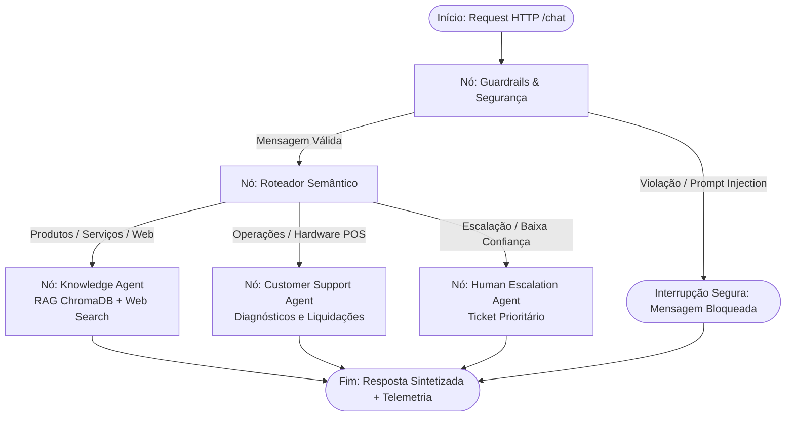

# Getnet Multi-Agent Support System

[](https://www.python.org/)
[](https://fastapi.tiangolo.com/)
[](https://github.com/langchain-ai/langgraph)
[](https://www.trychroma.com/)
[](https://www.docker.com/)
[]()
[]()

Sistema de suporte multi-agente para estabelecimentos e clientes Getnet, estruturado sobre um grafo de estados compilado com LangGraph, recuperação vetorial híbrida com ChromaDB e integração de ferramentas operacionais e de diagnóstico via FastAPI.

---

## Interface Visual & Observabilidade (/demo)

O sistema disponibiliza uma console visual interativa acessível diretamente pelo navegador, projetada para testes rápidos, inspeção operacional e auditoria técnica de ponta a ponta:

* **Coluna Esquerda (Cenários 1-Click)**: Catálogo com os 12 cenários de teste pré-configurados (10 cenários oficiais de referência do desafio Getnet + testes de injeção de prompt e transbordo humano). Permite disparar qualquer teste com um único clique.
* **Coluna Central (Chat Interativo)**: Interface de conversação em tempo real exibindo a resposta do assistente, o agente responsável pelo atendimento, as ferramentas acionadas e o tempo de execução da requisição.
* **Coluna Direita (Inspetor de Telemetria & Rastreabilidade)**: Painel de observabilidade técnica com cálculo de latência em milissegundos (`execution_time_ms`), métrica de confiança do roteador (`confidence`), auditoria e status de segurança dos guardrails (`is_safe`, `safety_violations`), lista de fontes/documentos e payload JSON bruto integral retornado pela API.

### Como Acessar a Interface:
* **Execução Local**: Acesse [`http://localhost:8000/demo`](http://localhost:8000/demo) no navegador com a aplicação em execução.
* **GitHub Codespaces**: Na aba **Ports** (Portas) do ambiente, localize a porta `8000`, assegure-se de que a visibilidade está configurada como *Public* e abra a URL gerada no caminho `/demo` (ex: `https://<codespace-id>-8000.app.github.dev/demo`).

---

## Sumário

- [Interface Visual & Observabilidade (/demo)](#interface-visual--observabilidade-demo)
- [1. Arquitetura do Sistema](#1-arquitetura-do-sistema)
  - [Grafo de Estados (LangGraph StateGraph)](#grafo-de-estados-langgraph-stategraph)
  - [Agentes Registrados](#agentes-registrados)
- [2. Decisões de Engenharia e Trade-offs](#2-decisões-de-engenharia-e-trade-offs)
  - [LangGraph StateGraph vs. Pipelines Lineares](#langgraph-stategraph-vs-pipelines-lineares)
  - [RAG Híbrido com ChromaDB (Dense Vector + Sparse Lexical Reranking)](#rag-híbrido-com-chromadb-dense-vector--sparse-lexical-reranking)
  - [Contratos Tipados com Pydantic v2](#contratos-tipados-com-pydantic-v2)
  - [Segurança de Execução e Isolamento](#segurança-de-execução-e-isolamento)
- [3. Como Executar e Modos de Operação](#3-como-executar-e-modos-de-operação)
  - [Modos de Operação (Resiliente Offline vs. Generativo)](#modos-de-operação-resiliente-offline-vs-generativo)
  - [Execução via Docker Compose](#execução-via-docker-compose)
  - [Execução Local](#execução-local)
  - [Endpoints e Documentação da API](#endpoints-e-documentação-da-api)
- [4. Testes Automatizados](#4-testes-automatizados)
- [5. Matriz de Cobertura dos Cenários de Avaliação](#5-matriz-de-cobertura-dos-cenários-de-avaliação)
- [6. Estrutura do Repositório](#6-estrutura-do-repositório)

---

## 1. Arquitetura do Sistema

O fluxo de processamento é governado por um grafo de estados compilado (`StateGraph`). Cada requisição HTTP recebida no endpoint `/chat` gera uma instância de `AgentState`, que é validada por nós sequenciais e condicionais até a emissão da resposta final e sua respectiva telemetria.

### Grafo de Estados (LangGraph StateGraph)



### Agentes Registrados

| Agente | Responsabilidade | Ferramentas |
| :--- | :--- | :--- |
| `GuardrailAgent` | Sanitização de entrada, detecção de *prompt injection*, *jailbreaks* e caracteres não conformes. | `regex_safety_evaluator` |
| `RouterAgent` | Classificação semântica de intenção, cálculo de confiança e transbordo para limiares baixos. | `intent_classifier` |
| `KnowledgeAgent` | Recuperação documental híbrida de produtos Getnet e busca externa na web em tempo real. | `chromadb_vector_search`, `knowledge_retriever`, `web_search_tool` |
| `CustomerSupportAgent` | Consulta de liquidação financeira de vendas, diagnóstico de POS e consulta a códigos de recusa. | `get_settlement_and_sales_status`, `diagnose_terminal_connectivity`, `get_declined_transaction_details` |
| `HumanEscalationAgent` | Criação de chamados prioritários com protocolo único (`GET-ESC-XXXX`) e transbordo humano. | `create_escalation_ticket` |

---

## 2. Decisões de Engenharia e Trade-offs

### LangGraph StateGraph vs. Pipelines Lineares
A orquestração foi estruturada com `StateGraph(AgentState)` compilado em vez de encadeamento condicional imperativo (`if/elif`).
* **Determinismo e Arestas Condicionais**: O roteamento entre agentes ocorre por transições formais (`guardrail_condition`, `router_condition`), permitindo rastreabilidade do caminho percorrido e isolamento de nós.
* **Extensibilidade**: A adição de novos agentes (ex: risco, antifraude ou cobrança) não altera a implementação dos nós existentes, apenas o registro de nós e arestas do grafo.
* **Estado Imutável**: O objeto `AgentState` trafega tipado, garantindo consistência entre ferramentas executadas, fontes documentais e tempos de execução.

### RAG Híbrido com ChromaDB (Dense Vector + Sparse Lexical Reranking)
Modelos de embedding vetorial denso podem apresentar perda de precisão em termos técnicos próximos (ex: "crediário em parcelas" versus "antecipação de recebíveis a prazo"). Para mitigar colisões:
* A coleção `getnet_kb` é indexada no ChromaDB com métrica de cosseno.
* O algoritmo de recuperação aplica ranking híbrido:
  $$\text{Score} = 0.50 \times \text{Similaridade Cosseno} + 0.30 \times \text{Sobreposição Léxica} + 0.20 \times \text{Boost de Termos no Título}$$
* Essa estratégia garante alta precisão em queries em português e inglês sobre os produtos Getnet (Get Clássica vs. Get Smart, Pix, Antecipação, Crediário 24x/36x e Link de Pagamento).

### Contratos Tipados com Pydantic v2
* Todos os payloads de entrada e saída (`ChatRequest`, `ChatResponse`, `AgentMetadata`) e modelos internos (`AgentState`, `RouteDecision`) utilizam schemas rigorosos do Pydantic v2.
* A síntese do modelo de linguagem é ancorada nos retornos das ferramentas operacionais ou nos trechos documentais indexados, evitando inconsistências em valores financeiros (`R$ 3.367,20`), horários de liquidação e códigos de recusa (`Código 51`).

### Segurança de Execução e Isolamento
* **Contêiner Não-Root**: O `Dockerfile` adota build multi-stage e executa a aplicação sob o usuário `appuser` (grupo `appgroup`), sem privilégios de root no host.
* **Busca Web com Fallback Transparente**: Em caso de timeout ou indisponibilidade da rede pública na ferramenta `web_search_tool`, o sistema retorna status `unavailable` e mensagem explícita, sem sintetizar dados fictícios de mercado ou clima.
* **Classificação por Expressões Semânticas**: O roteador avalia padrões compostos, evitando falsos positivos acionados por termos isolados (ex: "processo de antecipação" é direcionado ao Knowledge Agent, sem escalação indevida).

---

## 3. Como Executar e Modos de Operação

### Modos de Operação (Resiliente Offline vs. Generativo)

O sistema foi arquitetado com desacoplamento estrito da camada de inferência, permitindo operar em dois modos distintos:

1. **Modo Padrão (Offline / Resiliente / Zero-Friction — Default)**:
   * **Execução Autônoma Sem Custos**: Não requer chaves de API pagas, cadastros em nuvem nem quotas externas para funcionar.
   * **Pipeline Determinístico**: O fluxo completo do grafo LangGraph (`StateGraph`), a recuperação vetorial local no ChromaDB (`getnet_kb`), a sanitização de guardrails e as ferramentas operacionais de suporte rodam de forma 100% determinística no ambiente local/container.
   * **Busca Web Autêntica**: Consulta informações públicas externas em tempo real via DuckDuckGo (`ddgs`), com fallback gracioso e transparente em caso de indisponibilidade de rede.
   * **Síntese Factualmente Ancorada**: O motor de síntese renderiza respostas diretamente a partir dos esquemas JSON das ferramentas operacionais e do documento principal (Rank 1) do ChromaDB, garantindo exatidão matemática nos valores financeiros e conformidade institucional.

2. **Modo Generativo (Opcional — Modelos Fundacionais em Nuvem)**:
   * **Configuração via Ambiente**: Ativado automaticamente ao informar `GEMINI_API_KEY` (ou `OPENAI_API_KEY`) no arquivo `.env`.
   * **Linguagem Natural Fluida**: Utiliza modelos de ponta para expansão conversacional e personalização da linguagem, mantendo a ancoragem factual e a governança de segurança dos nós do grafo.

---

### Execução via Docker Compose

```bash
# 1. Configurar variáveis de ambiente
cp .env.example .env

# 2. Inicializar o serviço
docker compose up --build -d
```

Para encerrar a execução:
```bash
docker compose down
```

---

### Execução Local

```bash
# 1. Criar e ativar o ambiente virtual
python -m venv .venv
# Linux/macOS:
source .venv/bin/activate
# Windows PowerShell:
.venv\Scripts\Activate.ps1

# 2. Instalar dependências
pip install -r requirements.txt

# 3. Inicializar a aplicação
uvicorn src.main:app --host 0.0.0.0 --port 8000 --reload
```

---

### Endpoints e Documentação da API

Com o serviço ativo em `http://localhost:8000`:

* **Interface Visual de Testes e Telemetria**: `GET /demo`
* **Swagger / OpenAPI**: `GET /docs`
* **Health Check**: `GET /health`
* **Catálogo de Agentes**: `GET /agents`
* **Endpoint de Atendimento**: `POST /chat`

Exemplo de requisição:
```bash
curl -X POST "http://localhost:8000/chat" \
     -H "Content-Type: application/json" \
     -d '{
       "message": "When will the money from yesterday'\''s sales be deposited?",
       "user_id": "cliente1988"
     }'
```

---

## 4. Testes Automatizados

A suíte de testes contempla testes unitários de isolamento e validação de integração ponta a ponta dos cenários de referência.

```bash
# Executar suíte completa
pytest

# Executar cenários de integração
pytest tests/test_scenarios.py -v

# Executar testes unitários
pytest tests/test_unit.py -v
```

Resultado da execução:
```text
============================= test session starts =============================
platform win32 -- Python 3.13.3, pytest-9.1.1, pluggy-1.7.0
plugins: anyio-4.15.1, langsmith-0.14.17, asyncio-1.4.1
collected 45 items

tests\test_scenarios.py ..........                                       [ 22%]
tests\test_unit.py ...................................                   [100%]

============================= 45 passed in 14.78s =============================
```

---

## 5. Matriz de Cobertura dos Cenários de Avaliação

| ID | Pergunta de Avaliação | Agente Executado | Ferramenta Utilizada | Status |
| :-: | :--- | :--- | :--- | :-: |
| 1 | *"What's the difference between the Get Clássica and the Get Smart?"* | `KnowledgeAgent` | `chromadb_vector_search` | Aprovado |
| 2 | *"What's the weather forecast in Porto Alegre tomorrow?"* | `KnowledgeAgent` | `web_search_tool` | Aprovado |
| 3 | *"When will the money from yesterday's sales be deposited?"* | `CustomerSupportAgent` | `get_settlement_and_sales_status` | Aprovado |
| 4 | *"Do I need a bank account to receive my sales via Pix?"* | `KnowledgeAgent` | `chromadb_vector_search` | Aprovado |
| 5 | *"My card machine won't connect to the internet, what should I do?"* | `CustomerSupportAgent` | `diagnose_terminal_connectivity` | Aprovado |
| 6 | *"How does receivables advance (antecipação) work with Getnet?"* | `KnowledgeAgent` | `chromadb_vector_search` | Aprovado |
| 7 | *"What's the euro exchange rate today?"* | `KnowledgeAgent` | `web_search_tool` | Aprovado |
| 8 | *"My card machine is showing a transaction decline error."* | `CustomerSupportAgent` | `get_declined_transaction_details` | Aprovado |
| 9 | *"How many installments can I split a sale into with the crediário?"* | `KnowledgeAgent` | `chromadb_vector_search` | Aprovado |
| 10 | *"Can I sell through WhatsApp using the Payment Link?"* | `KnowledgeAgent` | `chromadb_vector_search` | Aprovado |

---

## 6. Estrutura do Repositório

```text
getnet-multiagent-support/
├── data/
│   └── getnet_kb.json             # Base de conhecimento de produtos Getnet para indexação vetorial
├── src/
│   ├── main.py                    # Servidor FastAPI, endpoints HTTP e lifecycle
│   ├── config.py                  # Pydantic Settings e configuração de log estruturado JSON
│   ├── agents/
│   │   ├── router.py              # Classificador semântico e gateway de roteamento
│   │   ├── knowledge.py           # RAG vetorial ChromaDB híbrido e busca web
│   │   ├── support.py             # Agente de suporte operacional ao lojista
│   │   ├── escalation.py          # Transbordo humano e geração de tickets
│   │   └── guardrails.py          # Sanitização e bloqueio de injeções de prompt
│   ├── core/
│   │   ├── graph.py               # Grafo de estados compilado com LangGraph (StateGraph)
│   │   ├── state.py               # Schemas de dados tipados (AgentState, RouteDecision)
│   │   ├── llm.py                 # Abstração de LLM e gerador estruturado
│   │   └── mock_db.py             # Catálogo de dados operacionais e códigos de recusa
│   ├── tools/
│   │   ├── balance_tools.py       # Consulta de vendas, liquidação e transações recusadas
│   │   ├── terminal_tools.py      # Diagnóstico de conectividade de terminais POS
│   │   └── web_search.py          # Consulta web em tempo real (ddgs) com fallback
│   └── static/
│       └── demo.html              # Interface web para avaliação interativa
├── tests/
│   ├── conftest.py                # Fixtures de sessão para TestClient e componentes
│   ├── test_scenarios.py          # Testes de integração dos 10 cenários de referência
│   └── test_unit.py               # Testes unitários de isolamento
├── Dockerfile                     # Build multi-stage seguro executado sob usuário não-root
├── docker-compose.yml             # Configuração Compose v2 com volumes e healthcheck
├── requirements.txt               # Dependências versionadas do projeto
├── .env.example                   # Modelo de variáveis de ambiente
└── README.md                      # Documentação técnica do sistema
```
